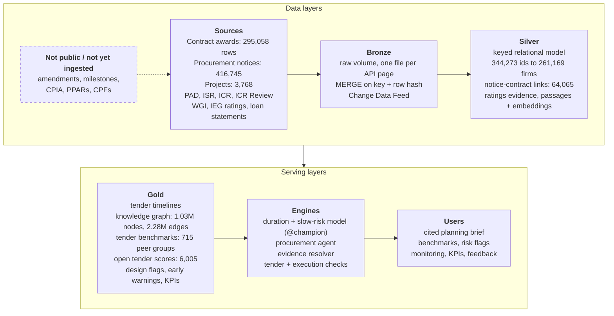
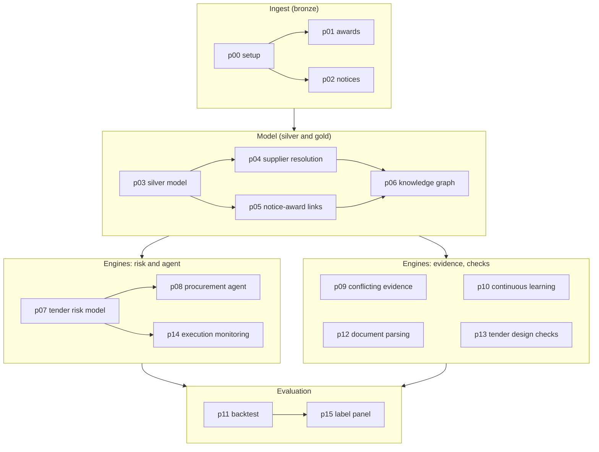
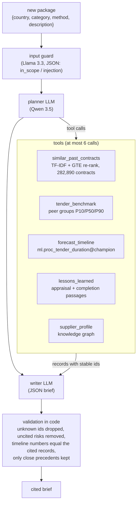

# World Bank Procurement Intelligence

A working prototype of the "AI-Powered Procurement Intelligence Platform" assessment, built on **Azure Databricks** (Delta Lake, Unity Catalog, MLflow, Model Serving) with real World Bank open data: the contract awards feed, procurement notices, project data, ISRs, ICRs and IEG reviews. It joins the transaction registry, tender notices and completion reports into one keyed model and knowledge graph, and gives cited, evidence-backed advice for a new procurement package. It reuses tables from my first submission, [worldbank-outcome-databricks](https://github.com/ShabadVaswani/worldbank-outcome-databricks) (project attributes, governance indicators, 50k document chunks), by joining to them without changing them.

## In one minute

- **Data model on real data:** 282,890 contracts, 379,820 notices and 678,025 bidder rows in a keyed silver model; 0 duplicate keys and 0 orphans on every check. 344,273 supplier ids resolve to 261,169 firms (precision 1.00, recall 0.90 on 100 labelled pairs; labels from the three-tier escalation in [panel](#panel-evaluation-labels-from-a-three-tier-escalation)).
- **Knowledge graph in Delta:** 1,026,462 nodes and 2,279,683 edges linking contracts, notices, bidders, projects, countries and document passages, with 0 dangling edges.
- **Tender duration model:** error of 76 days against 88 for the peer-group lookup an analyst would use, on 6,624 tenders it never saw; the P10-P90 range covers 80.7% of them after a conformal step. Trained only on cohorts the feed can fully observe, because the awards feed starts in FY2020. Evaluation numbers come from models trained before the test period; the registered `@champion` is the deployed refit on all data.
- **Cited procurement agent:** for a new package it writes a planning brief in which every claim cites a record id; code drops any id a tool did not return and checks every timeline number. Only close precedents are shown (0 to 5): 82% of them relevant; 19 of 20 briefs judged grounded.
- **Backtest as of the notice date:** 300 real tenders replayed with everything later hidden: timeline error 87 days vs 100 for the peer lookup; retrieved lessons named a problem the project's own completion report confirms in 38% of cases vs 8% for random passages. It also found what does not work yet: 19% of packages get no precedent, and 5 of 30 full briefs contained an unsupported claim (final escalated labels).
- **Brief facts checked in code:** a fact-check reads the counts, methods, regions and project ids in every cited sentence against the cited records and fixes or removes the claim. Briefs with an unsupported claim fell from 5 of 30 to 2 of 30, and 1 of 10 on new holdout briefs never used for tuning ([factcheck](#factcheck-brief-facts-checked-in-code-measured-again-on-the-review-pack-and-a-holdout)).
- **Conflicting evidence, measured:** 35 of 68 projects that IEG rated unsatisfactory still had a satisfactory last ISR. A written policy decides which source answers which question and always shows both.
- **Across the lifecycle:** tender design checks (672 of 1,939 international tenders advertised below the 30-business-day minimum drew 4.9 bidders vs 5.6), early warnings for 1,340 active projects (73 red, 238 amber, reasons cited), and table-aware parsing of long PDFs (plain chunking had lost 26.8% of table rows).
- **Continuous learning:** Change Data Feed on 9 tables; an incremental graph update equals a full rebuild row for row; drift checks, a retrain trigger and a champion/challenger gate; 9 pilot KPIs with baselines.
- **Engineering:** 371 unit tests on the shared package, ruff and pytest in CI, the pipeline as a Databricks Asset Bundle, and every notebook exported with its outputs to `executed/`.



*Architecture overview: raw sources land in bronze, are modelled in silver, and are served as gold tables to the engines and then to users. The dashed box lists sources that are not public or not yet ingested.*

## Where to look

| What | Where |
|---|---|
| Technical proposal, organised by the brief's four modules (PDF, and Markdown with Mermaid diagrams) | [docs/proposal.pdf](docs/proposal.pdf), [docs/proposal.md](docs/proposal.md) |
| Presentation deck (5 slides) and speaker notes with likely panel questions | [slides/procurement_intelligence.pptx](slides/procurement_intelligence.pptx), [PDF](slides/procurement_intelligence.pdf), [docs/speaker_notes.md](docs/speaker_notes.md) |
| Data gaps and how each one is handled | [docs/data_gaps.md](docs/data_gaps.md) |
| Notebooks as Databricks source / as run, with outputs | `notebooks/`, `executed/` |
| Evaluation labels: panel votes, tier-3 adjudication decisions with evidence and their log, final labels; the 30-brief review pack, the same 30 briefs after the fact-check, and 10 holdout briefs | `data/human_review/` ([adjudication_log.md](data/human_review/adjudication_log.md)) |
| Shared pure-Python code and its tests | `src/proc_intel/`, `tests/` |
| Slide diagrams (SVG, generated) and the scripts that build the PDF and deck | `docs/figures/`, `docs/build_pdf.py`, `docs/build_docs.py`, `slides/build_deck.py` |
| Every notebook diagram as Mermaid source with its pre-rendered image | [docs/diagrams.md](docs/diagrams.md) |
| Full reasoning behind each notebook's "Key design decisions" table | [docs/decision_log.md](docs/decision_log.md) |
| Results of each component | sections below: phase 1 results, then one section per component |

## Results in brief (snapshot 2026-10-20)

- **Bronze:** 295,058 award rows (= API count; idempotent `MERGE`: a re-run inserts and updates 0 rows) and 416,745 notices (184 country partitions plus the 200 notices that carry no country, because the API caps offsets at 100,000).
- **Silver:** 282,890 contracts, 295,058 contract-supplier rows, 379,820 notices (2018+), 678,025 bidder rows parsed from award notices, 399,502 supplier ids, 3,768 projects, 246 countries; all primary-key and foreign-key checks pass (0 duplicates, 0 orphans).
- **Supplier resolution:** 344,273 non-anonymised supplier ids (300,693 distinct raw spellings) -> 261,169 firm entities. On 100 labelled pairs as p04 ran them (labels made by an AI agent during the build): precision 0.97, recall 0.90 (band-weighted 0.99 / 0.90); on the final escalated labels (p15): precision 1.00 (95% CI 0.90-1.00), recall 0.90 (0.77-0.96) on 97 decided pairs. A random audit of 40 fuzzy links: 34 same firm or corporate group, 30 same legal entity.
- **Notice-to-contract links and timelines:** 64,065 tender links (audit by an AI agent during the build: exact reference 15/15, STEP id 9/9, reference variant 6/7, description 11/12 correct) and 242,812 award links (among one-to-one pairs whose award notice names a winner, 84.3% are confirmed by supplier id). 28,235 openly competed contracts (44.9% of 62,828) have a measured tender-to-signing duration; median 158 days (works 134, goods 129, consulting 314, non-consulting services 120). Counting limited-competition methods too, 56,156 contracts are timed (19.9% of all), median 123 days.
- **Knowledge graph:** 1,026,462 nodes and 2,279,683 edges in Delta, 0 dangling edges; GraphFrames motifs and plain joins give the same answers.

### Headline numbers (one definition each)

| Metric | Value | Exact definition |
|---|---|---|
| Contracts | 282,890 | distinct `wb_contract_number` in the awards feed (FY2020+), = rows of `proc_silver.contracts` and `proc_gold.tender_timelines` |
| Supplier ids | 399,502 | rows of `proc_silver.suppliers` (awards + award-notice bidders) |
| Resolved supplier ids | 344,273 | supplier ids that are not anonymised individual consultants (55,228 hashed ids) and not the one id-less row; 19 of them carry only a blank name and stay singletons |
| Firm entities | 261,169 | distinct `supplier_entity_id` over the resolved ids. `supplier_entities` has 316,398 rows = 261,169 + 55,228 individual consultants (one entity each) + 1 id-less row |
| Distinct raw names | 300,693 | distinct non-blank supplier spellings on the resolved ids' name records |
| Contracts with a tender notice before signing | 56,968 | `days_notice_to_signing IS NOT NULL` in `tender_timelines` (notices published after signing are never linked as the tender) |
| Contracts timed (all methods) | 56,156 | `is_timed`: the 56,968 minus 812 implausible (notice > 3 years before signing 130, bid deadline after signing 378, bid deadline before notice 304); 19.9% of contracts |
| Openly competed contracts timed | 28,235 | `is_timed AND competition = 'open'`; 44.9% of 62,828 openly competed contracts. The headline coverage and the phase-2 modelling population |
| Median notice -> signing | 158 days | over the 28,235 open timed contracts (123 days over all 56,156 timed, which include RFQ and individual-consultant selections) |

## Pipeline

| # | Notebook | Output |
|---|---|---|
| p00 | `p00_setup` | schemas `proc_bronze`, `proc_silver`, `proc_gold`; volume `proc_bronze.raw` |
| p01 | `p01_ingest_awards` | `proc_bronze.contract_awards` (FinancesOne DS00005, contract x supplier rows) |
| p02 | `p02_ingest_notices` | `proc_bronze.procurement_notices` (search API procnotices, 2018+) |
| p03 | `p03_silver_model` | keyed, documented silver model (below) with data-quality checks |
| p04 | `p04_supplier_resolution` | `supplier_entities`, `supplier_entity_map`, `supplier_match_links` + evaluation |
| p05 | `p05_link_notices_awards` | `notice_contract_links`, `proc_gold.tender_timelines` |
| p06 | `p06_knowledge_graph` | `proc_gold.kg_nodes`, `proc_gold.kg_edges` + multi-hop demo queries |



*Notebook pipeline p00-p15 by stage. Arrows between boxes show the order of the stages; arrows inside a box show direct inputs (p00-p06 follow `databricks.yml`; p07 feeds p08 and p14; p11 feeds p15).*

Ingestion is resumable and idempotent: every API page is saved as a file in the volume (a restart skips saved pages), and bronze tables are loaded with `MERGE` on a deterministic key with a row hash (a second run changes 0 rows; withdrawn awards are soft-deleted).

## Data model (proc_silver)

```
 +------------------+        +----------------------+        +------------------------+
 | dim_country      |<-------| dim_project          |<-------| notices                |
 | PK country_code  |   N:1  | PK project_id        |   N:1  | PK notice_id           |
 +------------------+        | FK country_code      |        | FK project_id          |
    ^   ^       ^            +----------------------+        | FK method, category    |
    |   |       |                       ^ N:1                +------------------------+
    |   |       +--------------+        |                       | 1:N            | N:M
    |   |                 N:1  |        |                       |                |
    |   |                +----------------------+    +--------------------+  +-----------------------+
    |   |                | contracts            |<---| notice_contract_   |  | notice_bidders        |
    |   |                | PK contract_id       | N:M|   links (p05)      |  | PK notice_id,         |
    |   |                | FK project_id        |    | PK notice_id,      |  |    supplier_id        |
    |   |                | FK borrower_country  |    |    contract_id     |  | role: awarded /       |
    |   |                | FK method, category  |    +--------------------+  |  evaluated / rejected |
    |   |                +----------------------+                            +-----------------------+
    |   |                           | 1:N                                               | N:1
    |   |                +----------------------+                                       |
    |   |                | contract_suppliers   |  (joint-venture members = rows;      |
    |   |                | PK contract_id,      |   amount is the contract value       |
    |   |                |    supplier_id       |   repeated, not a share)             |
    |   |                +----------------------+                                       |
    |   |                           | N:1                                               |
    |   |       N:1      +----------------------+                                       |
    |   +----------------| suppliers            |<--------------------------------------+
    |                    | PK supplier_id       |
    |                    +----------------------+
    |                               | N:1   via supplier_entity_map (p04)
    |                    +----------------------+
    +--------------------| supplier_entities    |
                         | PK supplier_entity_id|
                         +----------------------+

 dim_procurement_method (PK method_name, competition level) and dim_procurement_category (PK category_code)
 are referenced by contracts and notices.
 Reused from the outcome project by join: silver.country_year (WGI + macro) on (country_code, year),
 silver.projects / gold.active_project_scores / silver.rag_chunks on project_id.
```

Primary and foreign keys are declared in Unity Catalog (informational) and counted for duplicates and orphans in each notebook. Every table and column has a comment.

## Shared code and tests

- `src/proc_intel/`: pure Python, no Spark; HTTP retries, paging helpers, supplier-name normalisation, reference matching, award-notice parsing, similarity/clustering, entity resolution, country and procurement reference data.
- `notebooks/proc_common.py`: constants and Spark helpers (`MERGE`, publishing documented tables with keys, data-quality report); it puts `src/` on the path and ships the package to Spark's Python workers, so notebooks import the same code that the tests cover.
- `tests/`: pytest on small constructed inputs (`.venv/Scripts/python -m pytest -q`).
- `data/`: evaluation labels: supplier pairs, link audits and precedent labels (reference labels made by an AI agent during the build), and `data/human_review/` with the three-tier labels (panel, adjudication, final).
- `tools/export_executed.py`: exports a job run's notebook with outputs to `executed/*.ipynb`.
- `databricks.yml`: the pipeline as one Databricks workflow (Asset Bundle; not deployed).

## evidence (phase 2: conflicting evidence and continuous learning)

| # | Notebook | Output |
|---|---|---|
| p09 | `p09_conflicting_evidence` | `proc_bronze.rating_documents` (1,200 documents read), `proc_silver.project_ratings_evidence` (2,381 ratings), `proc_gold.project_evidence_resolution` (800 resolved answers) |
| p10 | `p10_continuous_learning` | Change Data Feed on 9 proc tables, `proc_gold.pipeline_checkpoints`, `drift_reports`, `pilot_kpis`, `pilot_feedback`; replay copies in `proc_sandbox` |

- **Ratings evidence (400 closed projects, hash sample of 1,368 with an IEG rating):** last ISR, mid-period ISR and ICR Review read from the Documents API text renderings with a fixed-width column parser; IEG's outcome read from the text matches IEG's own dataset for 381 of 381 reviews.
- **The disconnect, measured:** 35 of the 68 projects IEG rated unsatisfactory (51%) still had a satisfactory PDO rating in their last ISR; 9.6% of satisfactory last ISRs ended unsatisfactory. IEG rated the outcome below the ICR's self-rating for 91 of 381 projects (above it for 6).
- **Resolution policy:** `proc_intel.evidence.resolve_evidence(records, question_type)` ranks sources per question (outcome: IEG > ICR > last ISR > earlier ISR; current status: newest ISR), returns supporting and conflicting records with dates and document ids, a flag (conflict = 2+ points apart, disagreement = 1 point across the satisfactory line) and a confidence label. Outcome flags on the sample: 285 consistent, 57 disagreement, 58 conflict.
- **Incremental updates:** a replay of 7 held-back days plus 100 corrected notices (934 inserts, 100 updates) is read from the change feed and applied to the notice neighbourhood of the graph by one `MERGE` (3,290 inserts, 50 deletes); the result equals a full rebuild and the production `kg_nodes` / `kg_edges` (0 differences).
- **Refresh policy:** PSI / KS drift checks on the delay-model population (all stable this run), retrain trigger rules, a champion/challenger gate that takes metrics, a chunk-hash index refresh plan, freshness SLAs; daily job `wb_procurement_daily_incremental` in `databricks.yml` (paused). Pilot plan with phase 0/1/2 go/no-go criteria and KPI definitions in p10.

## risk (phase 2: tender duration benchmarks and slippage risk)

| # | Notebook | Output |
|---|---|---|
| p07 | `p07_tender_risk_model` | `proc_gold.tender_benchmarks` (715 peer groups), `proc_gold.open_tender_scores` (6,005 open notices), UC model `ml.proc_tender_duration` (v2, `@champion`), MLflow experiment `wb-procurement/proc_risk_experiment` |

- **Population:** openly competed, timed contracts whose tender notice falls between 2019-07-01 and 730 days before the snapshot (20,745 contracts; train = notices before 2023-07-01, 14,121; test = newer, 6,624). The awards feed truncates both ends: by notice year the median runs from 465 days (2018, only slow tenders reached the feed) to 95 days (2026, only fast ones are signed yet), so the window keeps only fully observable cohorts. Durations are capped at 730 days.
- **Features known on the notice date only:** notice type, method, category, advertising period, language, notice length; project region, sector, age, size, earlier tenders; WGI and GDP per capita for the year before; market history from the 36 months before (contracts, winning entities, foreign share, firms per award notice, past country x method median). Contract amount, review type and the outcome-risk score are excluded (award-time, not on the notice, and present only for projects still active in 2026).
- **Duration model (LightGBM quantile P10/P50/P90, rolling-origin tuned, conformal interval):** test MAE 76 days vs 88 for the peer-group lookup and 102 for global quantiles; mean pinball 24.6 vs 29.1; P10-P90 coverage 80.7% (68% before the conformal step) with an interval 12% narrower than the peer table's.
- **Slow-tender risk** (duration above the P75 of its method x category; base rate 25.0% train, 22.4% test): ROC-AUC 0.747 and PR-AUC 0.494 vs 0.584 / 0.295 for the peer group's slow rate. Re-advertisement (1.3-1.5% of contracts) is too rare and too poorly observed to model.
- **Survival view:** Kaplan-Meier per tender notice with unsigned notices censored. Within 180 days, 30-38% of notices are signed in every year 2019-2025, while the naive median of observed durations drops for the newest years. Curves flatten at the link rate (0.56-0.67), so cancellations cannot be told apart from link failures. Weibull AFT time ratios: Request for Bids 0.42x the other open methods, Latin America 1.28x vs Europe and Central Asia.
- **Interface:** `proc_intel.risk.benchmark_lookup(rows, country, method, category)` returns the finest peer group with at least 30 contracts (country -> region -> method x category -> category) and the level it used; table schemas are at the top of p07.

## rag (phase 2: procurement agent with contextual retrieval)

| # | Notebook | Output |
|---|---|---|
| p08 | `p08_procurement_agent` (tools and loop in `proc_rag_core`) | `proc_silver.lesson_documents` (300 completion reports), `proc_silver.lesson_chunks` (4,495 procurement-relevant passages with GTE embeddings), `proc_gold.agent_eval_results` (23 evaluation cases), MLflow experiment `wb-procurement/proc_agent_experiment` (one trace per run) |



*Agent flow (p08): input guard, bounded tool loop, writer, then validation in code.*

- **What it does:** for a new package `{country, category, method, description}`, a Llama 3.3 input guard checks scope and injection, then Qwen 3.5 (thinking off) plans up to 6 tool calls, and writes a JSON brief: timeline (P50/P90 from the benchmark), market approach, 2-5 risks with mitigations, up to 5 precedents, evidence gaps. Every claim cites record ids (`contract:`, `benchmark:`, `document_chunk:`, `lesson_chunk:`, `supplier_entity:`); code drops ids no tool returned, removes uncited risks and checks timeline numbers against the cited benchmark.
- **Tools:** `similar_past_contracts` (hashed TF-IDF over all 282,890 contracts, description + tender notice + project name, top 30 re-ranked with GTE), `tender_benchmark` (reads the risk component's `tender_benchmarks`, most specific peer group with at least 20 contracts; computes the same groups from `tender_timelines` if the table is missing), `lessons_learned` (exact GTE search over 16,623 appraisal passages from risk / fiduciary / procurement sections plus the 4,495 completion-report passages), `supplier_profile` (knowledge-graph edges held as integer arrays: wins, countries, award-notice roles, co-bidders, in about 5 s).
- **Evaluation (20 packages written during the build from real contracts, source project held out; 3 guard cases):** precedents precision@5 0.63 TF-IDF vs 0.75 with re-ranking (gpt-oss judge; 90% agreement with 30 reference labels made by an AI agent during the build); citation validity 1.00 (0 invented ids); groundedness judge 16/20 (on reading the four: 2 fail on "evidence gaps" statements, 1 on a harness artefact, 1 real error); 3.7 tool calls per brief, 0 forced, 0 invalid; median 14.9 s; guard 3/3. Qwen chosen over Llama 3.3 on three trial packages (equal quality, faster, cheaper).
- **Pure logic and tests:** `src/proc_intel/agent_tools.py` (search ranking, argument checks, brief schema and validation), `src/proc_intel/lessons.py` (completion-report sections, passages, relevance rules), `tests/test_agent_tools.py`; evaluation data in `data/agent_eval_packages.json` and `data/agent_relevance_labels.csv`.

## gaps (phase 3: document parsing, tender design, execution monitoring, data gaps)

| # | Notebook | Output |
|---|---|---|
| p12 | `p12_document_parsing` | `proc_bronze.parsed_documents` (10 PADs, 941 pages), `proc_silver.doc_elements` (12,158 headings / text blocks / tables), `proc_silver.doc_chunks_v2` (2,064 chunks, 362 of them tables, GTE embeddings) |
| p13 | `p13_tender_design_checks` | `proc_silver.tender_requirements` (400 IFB notices), `proc_gold.tender_design_peers` (1,127 peer groups), `proc_gold.tender_design_flags` (3,227 flags on 8,146 IFBs) |
| p14 | `p14_execution_monitoring` | `proc_bronze.loan_statements` (40,842 loan-snapshot rows), `proc_bronze.monitoring_isr_documents` (300 latest ISRs), `proc_gold.early_warnings` (1,340 active projects) |
| - | `docs/data_gaps.md` | every missing or incomplete source met in phases 1-3: detection, handling, residual impact, numbers |

- **Long reports (p12):** PyMuPDF layout parsing (font-size / bold headings, ruled tables with a quality gate, captions, tables merged across page breaks, annex flag); narrative chunks never cross a section, tables become one chunk or row groups with the header repeated, every chunk carries a contextual header. On the same 10 PADs the old plain-text chunks had lost 26.8% of identifiable table rows and split 4.5% (control: 97.2% of narrative sentences intact). On 12 table-fact questions hit@3 is 10/12 new vs 9/12 old and hit@10 12/12 vs 11/12, but hit@1 is 5/12 vs 8/12; without the contextual header the new chunks find 3/12.
- **Tender design (p13):** rules read the notices, Qwen (strict JSON) fills only what the rules missed (agreement with rules on 40 check notices: 23/24 market approaches, 13/13 amounts). International IFBs advertised below the Regulations' 30 business days (para 5.36): 672 of 1,939, with fewer bidders (4.9 vs 5.6) and more single-bidder outcomes (28.5% vs 20.3%). Packages above the country P90 draw more bidders but sign later (196 vs 115 days). Notices rarely state qualification criteria (turnover 9.8%, experience 5.2%). Agent-tool interface: `proc_intel.tender_checks.check_tender_design(notice, peers) -> list[flag]`.
- **Execution monitoring (p14):** six indicators (stalled tenders, slow signings, disbursement lag vs peers, closing date moved, ISR ratings, SORT fiduciary risk) from p07 scores, timelines, FinancesOne loan statements and the latest ISR; alerts red 73, amber 238, watch 447, none 582, each with reasons and record citations. ISRs no longer rate procurement (the SORT fiduciary row is used), and 2026 ISR renderings use a new cell-per-line layout (120 of 300; a second parser). Backtest: a weak mid-period ISR goes with IEG-unsatisfactory outcomes 23.8% vs 14.0%. Contract milestones, amendments and payments are not public; production would read STEP, Client Connection and PRAMS.
- **Pure logic and tests:** `src/proc_intel/doc_parse.py`, `tender_checks.py`, `monitoring.py`; `tests/test_doc_parse.py`, `test_tender_checks.py`, `test_monitoring.py`.

## assistant upgrades (phase 3: close precedents only, model-based timeline, stable interface)

| # | Notebook | Output |
|---|---|---|
| p08 | `p08_procurement_agent` (tools in `proc_rag_core`) | new tool `forecast_timeline`; `proc_gold.agent_eval_results` (23 rows, now with precedent and timeline columns); `run_agent(package) -> dict` for other components |

- **Precedents, 0 to 5:** a re-ranked contract is a precedent only if GTE cosine >= 0.68 **and** TF-IDF cosine >= 0.08 (lower ranks fill freed places). Chosen on 200 judged candidates (best F0.5; a cosine cut alone fails because the best relevant match scores anywhere from 0.70 to 0.87 depending on the query). On the evaluation: precision of cited precedents 0.82 (76/93) vs 0.74 before; 1 brief with no precedent (e18 speedboats), correctly, since none of its 10 candidates was relevant. The writer prompt, the JSON schema (empty list allowed) and `validate_brief` (only search hits marked `close_precedent`; "no close precedent found" added to the evidence gaps) enforce it.
- **Timeline = model forecast + peer group:** `forecast_timeline` scores `ml.proc_tender_duration@champion` (loaded by `models:/` URI) on planning-time features built by `proc_intel.forecast.planning_features`; unknown notice facts get documented defaults (advertising period and notice length = method x category medians of the training cohort, notice type by method, language by country, notice date = today) listed in the record's `assumptions`; record id `forecast:<hash>`. Methods the model never saw (direct selection) return an unscored record and the brief falls back to the peer group, saying so. The code checks that every timeline number equals its cited forecast or benchmark record and computes the forecast-vs-peer difference itself.
- **Before / after (same 20 + 3 cases, same judge):** groundedness 16/20 -> 19/20 (the one "no" is a harness artefact); citation validity 1.00 -> 0.995 (one malformed id, dropped by code); precision@5 of the ranking 0.75 -> 0.75; guard 3/3; 4.25 tool calls per brief, none forced; median latency 14.9 s -> 23.1 s (13.6 s in the previous run with the same tools: the endpoints are shared).
- **Timeline vs actual (20 timed source contracts, mostly in-sample for both):** P50 MAE peer group 85 days, model with package fields only 91, + project id 80, + real notice facts 60. Planning-time defaults cost the model its edge; the project id and planned notice facts are worth giving.
- **Interface:** `run_agent(package)` returns `status`, `brief`, `text`, `timeline` {`model`, `peer_group`}, `precedents`, `n_precedents`, `cited_ids`, `cited_records`, `citation_validity`, `flags`, `guard`, `tool_calls`, `latency_s`, `tokens`, `dbu` (documented at the top of p08).
- **Code and tests:** `src/proc_intel/forecast.py` + `tests/test_forecast.py`; `agent_tools.py` (precedent rule and its chooser, timeline validation, `compare_medians`) + `tests/test_agent_tools.py`.

## backtest (phase 3: replaying real tenders as of their notice date)

| # | Notebook | Output |
|---|---|---|
| p11 | `p11_backtest` | `proc_gold.backtest_results` (833 metrics, long format), `proc_gold.backtest_packages` (400 replayed packages), `proc_gold.backtest_summary` (9 headline lines); `data/human_review/review_briefs.csv` + `review.html` (30 agent briefs, labelled in p15) |

- **Design:** 300 openly competed tenders from the p07 test period (notices 2023-07-01 .. 2024-10-13), stratified by region x category (28 strata, at least 5 each, fixed seed, one lot per notice, one tender per project: 299 projects, 92 countries), each replayed on its notice date with its own project and everything dated later hidden from the agent's tools (`as_of`; every returned record re-checked by `leak_violations`). The registered `@champion` was refit on the test period, so the backtest refits its recipe at the cutoff (model A; reproduces p07's test MAE within 1 day) plus a strict as-of model B; the champion appears only as an in-sample contrast.
- **Timeline (6,624 test contracts):** P50 error 75 days (model A) and 78 (B) vs 88 for the peer table and 89 for the agent's benchmark tool; P10-P90 coverage 81% / 83% vs 77% / 76%. On the 300 packages: 87 days (95% CI 77-98) vs 100. The model does not beat the peer table for consulting services (134 vs 127 days). Slow-tender ROC-AUC 0.74 vs 0.58. The in-sample champion would have "scored" 50 days and 95% coverage.
- **Precedents (300 packages, gpt-oss judge):** precision@5 of the ranking 0.66 with GTE re-ranking vs 0.59 TF-IDF; as the agent shows them (phase-3 rule): 3.3 per package, 77% relevant, 73% of packages get at least one relevant precedent, 19% none (non-consulting services 47%). The rule-based proxy (same category, method family and sector) agrees with p08's agent reference labels on 16 of 30 pairs (kappa 0.21) and is not usable; the judge agrees with agent reference labels on 20 of 23 backtest pairs.
- **Lessons (100 projects with a completion report):** retrieved lessons named a problem that the project's own completion report says occurred in 38% of cases vs 8% for random passages (yes or partial 84% vs 22%; judged blind; judge agrees with an AI agent's spot-check on 13 of 15).
- **Review pack:** 30 full `run_agent` briefs (as of the notice date, forecast tool pointed at model A) with cited records and the actual outcome; labelled by the three-tier escalation in p15 (final: actual inside the cited range 20/30, unsupported claim 5/30; after the fact-check 2/30, see [factcheck](#factcheck-brief-facts-checked-in-code-measured-again-on-the-review-pack-and-a-holdout)). `data/human_review/score_labels.py` (or p11 section 5b) compares any filled label columns with the automatic scores.
- **Code and tests:** `src/proc_intel/backtest.py` (allocation and stratified hash sampling, design weights, bootstrap, interval metrics, leak check, relevance proxy, kappa, judge parsing, review agreement, HTML pack) + `tests/test_backtest.py` (22 tests).

## panel (evaluation labels from a three-tier escalation)

| # | Notebook | Output |
|---|---|---|
| p15 | `p15_label_panel` | `proc_gold.label_panel` (660 votes: item x judge x field, with one-line rationales); `data/human_review/panel_labels.csv` (220 item x field rows: panel value, three votes, disagreement flag); `adjudication_decisions.csv` + `adjudication_log.md` (tier 3: 24 decisions with evidence); `final_labels.csv` (220 rows, merged by `apply_adjudication.py`); `adjudicate.html` (the escalated items, also usable by a human reviewer). `panel_labels`, `adjudication_decisions` and `final_labels` with the suffixes `_v1r` (the first 30 briefs re-judged with the updated rubric and facts lines), `_v2` (the briefs after the fact-check) and `_holdout` (10 holdout briefs) hold the later rounds, see [factcheck](#factcheck-brief-facts-checked-in-code-measured-again-on-the-review-pack-and-a-holdout) |

- **Method.** Evaluation labels come from a three-tier escalation. (1) Checks that code can decide are automatic: whether the actual duration falls inside the brief's cited P10-P90 range, and citation validity. (2) Everything else is labelled independently by a panel of three LLM judges from different model families, with one written rubric per item type, temperature 0 and strict JSON: gpt-oss-120b, Llama 4 Maverick and Qwen 3.5 for supplier pairs (up to 3 contracts shown per record); gpt-oss-120b, Llama 4 Maverick and Llama 3.3 70B for briefs, because Qwen wrote the briefs. The judges read and code decides: timeline_ok from the P10 / P90 / actual days they read, counts from a verdict per listed precedent and risk, unsupported claims by pooling every quoted claim and having every judge check each one. (3) Items where the judges disagree escalate to an AI adjudicator agent with full access to the warehouse tables and the web, which records written evidence for each decision ([adjudication_decisions.csv](data/human_review/adjudication_decisions.csv); the reviewable log with votes, SQL and web sources is [adjudication_log.md](data/human_review/adjudication_log.md)). Independent validation by procurement specialists is part of the pilot plan.
- **Escalation volume.** Supplier pairs: 100 -> 90 settled unanimously by the panel, 10 escalated. Briefs: 120 fields (30 briefs x 4 questions; timeline decided by code) -> 106 settled, 14 escalated on 13 briefs. Tier 3 made 24 decisions, each with evidence (warehouse queries on award-notice firm counts and project ids; a web check on two firm names). It overturned 7 of 24 panel majorities (pairs 54, 68, 89; claim verdicts r05, r06; risk counts r19, r21), confirmed 15, and settled 2 items where the judges had no majority. It confirmed 2 real errors in the agent's briefs from the data: a precedent wrongly described as "same project" (r06) and an overstated firm-count range (r10: "2 to 6 firms in the same project", where the same-project contracts had 2 and 5).
- **Panel agreement (tier 2).** Pairs 90/100 unanimous (Fleiss' kappa 0.86); timeline 30/30 (1.00); precedents 26/30 unanimous (within one 0.98); risks 19/30 (within one 0.92); unsupported claim 21/30 (kappa 0.42). The panel majority agreed with the earlier build labels (made by an AI agent) on 96 of 100 pairs (agreement, not accuracy).
- **Final results.** Entity resolution at threshold 0.70: 97 pairs decided (3 left "unsure": two common personal names and one firm whose relation could not be established), precision 1.00 (95% CI 0.90-1.00), recall 0.90 (0.77-0.96) (36 merged correctly, 0 wrongly, 4 missed). Review pack, 30 replayed briefs: actual duration inside the cited range 20/30; 22 briefs list precedents, 3.3 relevant on average, 90% of listed precedents relevant, 8 list none; 3.4 relevant risks per brief; an unsupported claim in 5/30 (17%). These are the first version's briefs; the fact-checked briefs and the holdout are in [factcheck](#factcheck-brief-facts-checked-in-code-measured-again-on-the-review-pack-and-a-holdout).
- **Limitations.** A unanimous panel can still be wrong (pair 80); the two Meta judges err together; the rubrics were sharpened after seeing answers on these same items, so agreement is optimistic; the tier-3 adjudicator is an AI agent, so its decisions carry written evidence a person can audit but have not yet been reviewed by procurement specialists.
- **Code and tests:** `src/proc_intel/panel.py` (rubrics, parsing, majority, disagreement rule, pairwise agreement, Fleiss' kappa, claim pooling, merge) + `tests/test_panel.py` (41 tests).

## factcheck (brief facts checked in code, measured again on the review pack and a holdout)

| # | Notebook | Output |
|---|---|---|
| p16 | `p16_brief_factcheck` | the same 30 review packages written again with the fact-check: `proc_gold.review_briefs_v2`, `data/human_review/review_briefs_v2.csv` (columns of `review_briefs.csv`, label columns empty) and `review_briefs_v2_full.csv` (every cited contract record shown with its facts line) |
| p17 | `p17_holdout_briefs` | 10 new holdout packages, never used to tune the writer or the check: `data/human_review/review_briefs_holdout.csv` and `review_briefs_holdout_full.csv` |

- **Problem.** On the first review pack, 5 of 30 briefs had an unsupported concrete claim next to real citations, for example a precedent called "same project" that belongs to another project (r06), and "2 to 6 firms in the same project" where the same-project contracts had 2 and 5 (r10). The citation check cannot see these, because every cited id is real.
- **Facts the writer can quote.** Each contract record carries a facts line: project | country | region | method | signing year | firms in the award notice (distinct firms in the award-linked notices, the way the adjudicator counted them, or "not recorded"). The writer also sees the package's own facts, and a prompt rule allows counts, ranges, methods and project / country / region relations only from a cited record's fields. Evidence gaps can cite `tool_log` records that state what a tool searched and did not find.
- **The code fact-check** (`proc_intel.factcheck.factcheck_brief`, after `validate_brief`). It reads every cited sentence (timeline summary, market approach, each risk, each precedent's reason; not the mitigations, which are advice, nor the package summary). Firm counts and ranges, days, percentages, project ids, methods and the relations "same project", "same country" and "in the region" are checked against the facts of the records the sentence cites. Quantified claims such as "all five precedents" must hold for every cited contract, and a firm range over records with missing counts must say so. A wrong count that the records can correct is replaced with the verified value (`factcheck_fixed`); any other unsupported claim removes the sentence (`factcheck_removed`). Interpretive phrases ("similar scope") and advice ("invite at least 5 firms") are left alone.
- **Re-run (p16).** The same 30 packages, replayed exactly as p11 does (same notice date, held-out project, cutoff model and benchmarks). The writer runs Qwen 3.5 with thinking on, so the before / after difference is the combined effect of the facts lines, the prompt rule, thinking and the check. On the final pack the check read 184 checkable claims and changed 0 briefs: the writer no longer produced the errors it targets, and the check stays as a safety net. Citation validity is 1.000 on every brief; 23 briefs are complete and 7 partial (22 / 8 before); median latency is 46.2 s per brief (28.6 s before). All reported briefs come from the Databricks endpoints; a pass through another provider was slower and worse, and was not used.
- **Holdout (p17).** 10 packages from the backtest's test period that share no contract, tender notice or project with the 300 backtest packages, picked in a fixed hash order to spread categories, regions and methods. On the holdout the check read 95 claims and changed 1 brief (h03). That removal was wrong: "QCBS or Consultant Qualification Selection" was true of the precedents, but the check tests each method on its own.
- **Labels.** All three packs below are on final three-tier labels: code for the timeline, the three-judge panel, and the AI adjudicator for disagreements ([adjudication_log.md](data/human_review/adjudication_log.md)). The briefs rubric for these rounds treats mitigations as advice, checks evidence gaps against the cited records, and shows the judges each cited record's facts line and the package facts. On the fact-checked pack 9 fields were escalated on 9 briefs (2 panel majorities overturned, both to "supported" on warehouse data, 7 confirmed); on the holdout 6 fields on 5 briefs (0 overturned, 5 confirmed, 1 with no majority). r30 was passed unanimously by the panel, but the adjudicator found its "4 of 5" Request for Quotations count wrong (all five cited contracts used it); it is counted as unsupported with the owner's approval.

| Measure | First version | First version, re-judged like for like | After the fact-check | Holdout, 10 new briefs |
|---|---|---|---|---|
| Briefs | 30 | 30 | 30 | 10 |
| Actual duration inside the cited range | 20/30 | 20/30 | 20/30 | 7/10 |
| Briefs listing precedents | 22/30 | 22/30 | 23/30 | 9/10 |
| Mean relevant precedents (briefs listing any) | 3.32 | 3.23 | 3.30 | 4.11 |
| Share of listed precedents relevant | 90% | 88% | 88% | 93% |
| Relevant risks per brief | 3.40 | 3.33 | 3.60 | 3.40 |
| Briefs with an unsupported claim | **5/30** (r06, r10, r17, r26, r30) | **5/30** (r07, r14, r16, r20, r29) | **2/30** (r18, r30) | **1/10** (h08) |

- **Reading it.** Briefs with an unsupported concrete claim fell from 5 of 30 to 2 of 30, and the holdout, which nothing was tuned on, has 1 of 10. The like-for-like baseline (the first briefs re-judged with the same rubric and facts lines) is also 5 of 30, on different briefs: the facts lines exposed region and method claims that the first labelling missed. Duration coverage, precedent relevance and risks held.
- **What is left.** r18 calls a Request for Proposals package "consistent with" a precedent that used Request for Bids; r30 says Request for Quotations was used in "4 of 5" contracts where all five cited contracts used it. h08 states a detail of a lesson passage that is cut off in the record the judges see; against the full passage it is supported.
- **Sensitivity.** Without r30 the fact-checked pack would be 1 of 30. r26 and h07 were decided as supported on warehouse data that the cited records do not show; on a visible-records-only reading the counts would be 3 of 30 and 2 of 10. Judged against the full lesson passage, h08 would make the holdout 0 of 10.
- **Limits.** 30 and 10 briefs are small samples: one brief moves the rate by about 3 points on the pack and 10 on the holdout. The rubric and the writer rules were designed after reading the first pack's errors, which is why the holdout matters. The adjudicator is an AI agent, and specialist validation is part of the pilot plan.
- **Code and tests:** `src/proc_intel/factcheck.py` + `tests/test_factcheck.py`; `src/proc_intel/holdout.py` (holdout selection) + `tests/test_holdout.py`; `data/human_review/apply_adjudication.py --out ... --pairs-from final_labels.csv` merges a briefs-only panel file with the pair rows of the first round.
