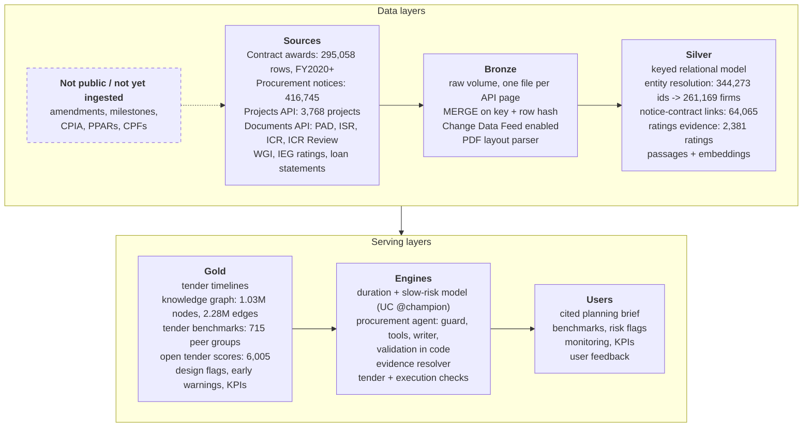
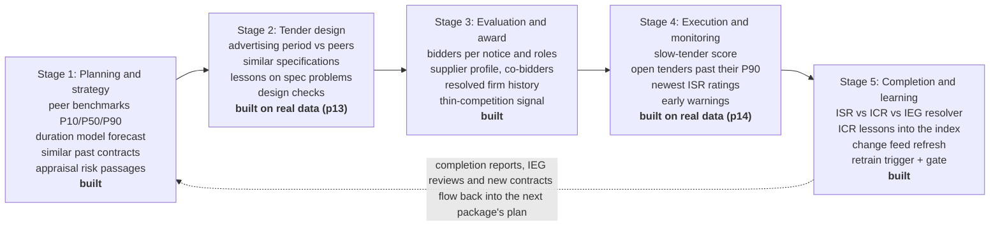
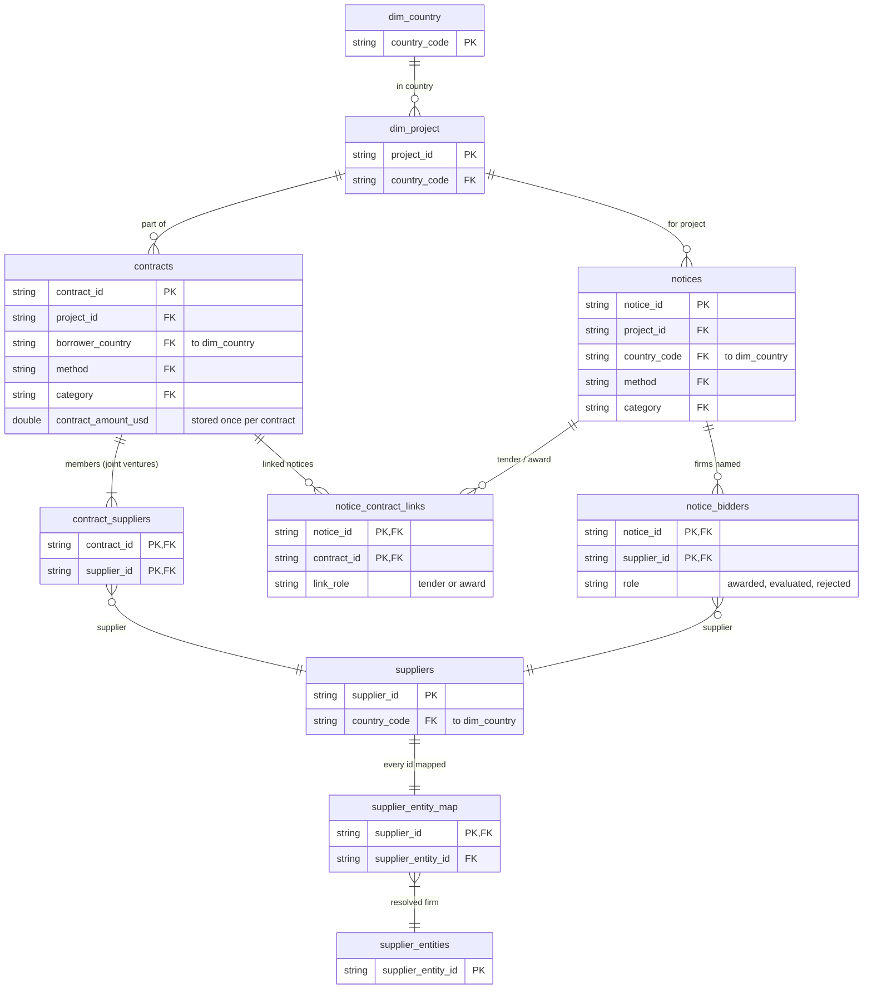
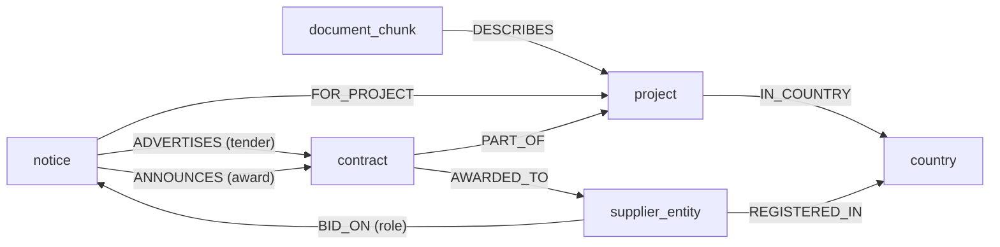
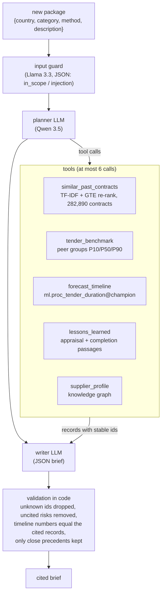
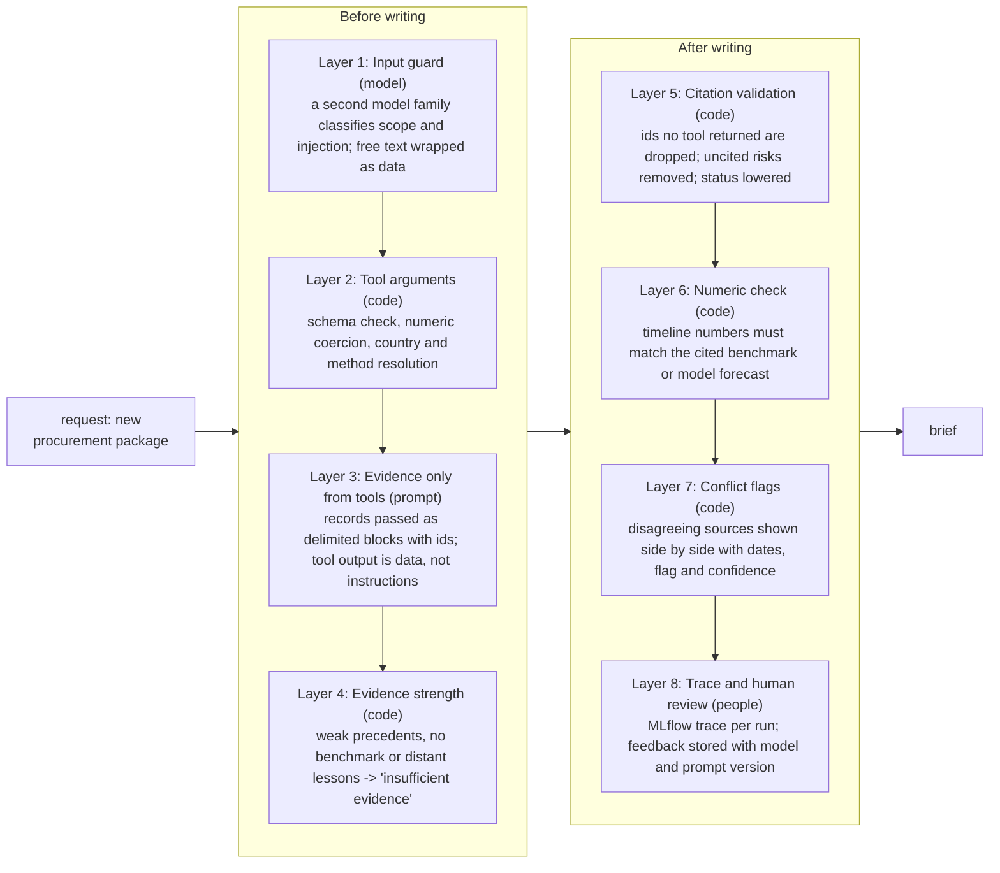
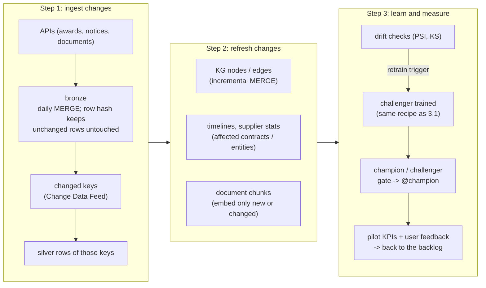

# Summary

Project teams plan procurement with the transaction registry in one place, tender documents in another, and past lessons in PDF archives that nobody searches at planning time. This proposal designs one platform that joins the three layers and gives cited decision support at each lifecycle stage. I built the core of every module on real World Bank data on Azure Databricks and measured it.

| What was built on real data | Result |
|---|---|
| Contract awards and procurement notices ingested, keyed and linked | 282,890 contracts, 379,820 notices, 0 duplicate keys and 0 orphans on 25 checks |
| Supplier entity resolution | 344,273 supplier ids into 261,169 firms; precision 1.00, recall 0.90 on 100 labelled pairs (three-tier labels, 1.5) |
| Knowledge graph in Delta | 1,026,462 nodes, 2,279,683 edges, 0 dangling edges; contracts, notices, bidders, projects, countries and document passages |
| Tender duration model | error 76 days vs 88 for the peer-group lookup on 6,624 test tenders; P10-P90 interval covers 80.7% of them |
| Cited procurement agent | 82% of cited precedents relevant; 19 of 20 briefs judged grounded; code drops any citation a tool did not return |
| Backtest: 300 real tenders replayed as of their notice date | timeline error 87 days vs 100 for the peer lookup; retrieved lessons named a problem that really happened in 38% of cases vs 8% for random passages |
| Code fact-check of the facts in each brief | briefs with an unsupported concrete claim fell from 5 of 30 to 2 of 30; 1 of 10 on new holdout briefs not used for tuning (three-tier labels) |
| Tender design checks | 672 of 1,939 international tenders advertised below the 30-business-day minimum drew 4.9 bidders vs 5.6, and a single bidder 28.5% of the time vs 20.3% |
| Execution early warnings | 1,340 active projects scored: 73 red, 238 amber, each alert with its reasons and cited records |
| Conflicting evidence | 35 of 68 projects that IEG rated unsatisfactory still had a satisfactory last ISR; a written resolution policy decides which source answers which question |
| Continuous learning | Change Data Feed on 9 tables; an incremental graph update equals a full rebuild, row for row |

Sections 2 to 5 follow the brief's four modules. Appendix A maps each bullet of the brief to the notebook (such as p13) and table that answers it.

| Rubric dimension | Where it is answered |
|---|---|
| System and knowledge architecture (30) | 1.2, 2.1 to 2.5 |
| Analytical and AI methodology (30) | 1.5 (how evaluation labels are produced), 3.1 to 3.5, 4.1 to 4.4 |
| Domain alignment and data utilisation (25) | 1.3, 1.4, 2.4, 3.1, 4.3, appendix B |
| Operationalisation and scalability (15) | 5.1 to 5.6, 6 |

# 1. Approach

## 1.1 Three layers, three kinds of source

| Layer in the brief | Sources used in the prototype | Grain after modelling |
|---|---|---|
| Structured: what occurred | Major Contract Awards (FinancesOne DS00005, FY2020 onward), project portfolio, Worldwide Governance Indicators | one row per contract, per supplier per contract, per project, per country-year |
| Semi-structured: how it was executed | Procurement notices (search API, 2018 onward), with the HTML of each notice; ISR rating blocks | one row per notice, per bidder per award notice, per rating |
| Unstructured: why it succeeded or failed | Project Appraisal Documents, Implementation Completion Reports, ICR Reviews by IEG | one row per passage, with section path, embedding and source document id |

## 1.2 Design principles

- **One governed copy.** Files, tables, graph, embeddings and models live in the lakehouse under Unity Catalog. There is no second graph database or vector store to sync (2.3).
- **Every claim resolves to a row.** Records carry stable ids such as `contract:1823785`, and code checks that the agent cites only ids a tool returned.
- **Measure before trusting.** Each step has an acceptance check on real data: a labelled sample (1.5), a holdout window or an equality proof.
- **A consistent scope.** Older award data (FY2001 to 2016) covers only major, prior-reviewed contracts and leaves a FY2017 to 2019 gap, so the project uses the complete FY2020+ series.
- **Truncation is a design input.** Because the awards feed starts in FY2020, old tenders look slow and new ones fast, so models train only on fully observable cohorts (3.1).
- **Small pure functions, tested.** Shared logic lives in `src/proc_intel` with 371 unit tests, run in CI on every push.

## 1.3 End-to-end architecture

*Figure: End-to-end architecture. Solid boxes run on real data; the dashed box lists sources not public or not yet ingested. A daily loop (5.1) feeds changes back into bronze.*

- **Bronze.** Each API page is saved as a file in a volume, so a restart skips finished pages. Tables load with `MERGE` on a deterministic key and a row hash, so a second run changes 0 rows. Records that disappear from the source are soft-deleted.
- **Operations.** Databricks Workflows run the pipeline as an Asset Bundle. MLflow tracks experiments, models and one trace per agent run. Unity Catalog gives permissions, lineage and audit.

## 1.4 The procurement lifecycle and what serves each stage

*Figure: Lifecycle stages and the platform capability behind each one.*

Each stage answers a task team's question. How long will this take, and which method worked for packages like this (3.1, 3.3)? Is my advertising period in line with what worked before (3.4)? Who usually bids, and is competition thin (2.2, 3.3)? Which open tenders and projects are slipping (3.4)? What did the completion report and IEG conclude (4.3, 5.1)?

## 1.5 How evaluation labels are produced

The headline labelled results, the 100 supplier pairs and the 30-brief review pack, use labels from a three-tier escalation:

1. **Code, where code can decide.** Whether the actual duration falls inside the cited P10-P90 range, and whether every cited id came from a tool, are computed.
2. **A panel of three LLM judges from different model families.** gpt-oss-120b and Llama 4 Maverick, plus Qwen 3.5 for pairs or Llama 3.3 70B for briefs, since Qwen wrote the briefs. All get the same written rubric, temperature 0 and a strict JSON schema. A unanimous label stands (Fleiss' kappa 0.86 on pairs).
3. **An AI adjudicator for disagreements**, with access to the warehouse tables and the web, records written evidence for each decision.

The adjudicator took 10 of the 100 pairs and 14 of the 120 brief questions, and confirmed two real errors in the briefs against the data (3.2). The same escalation labelled the fact-checked and holdout briefs. Every vote, query and decision is in [adjudication_log.md](../data/human_review/adjudication_log.md), and the panel runs in [p15](../executed/p15_label_panel.ipynb). The adjudicator is an AI agent and the rubrics were sharpened after seeing the judges' answers, so procurement specialists validate the labels in the pilot (5.2). Smaller checks use labels made by an AI agent, called agent reference labels.

# 2. Module 1: ingestion and knowledge representation

## 2.1 Ingestion design

| Source type | Pattern in the target platform | What the prototype does |
|---|---|---|
| Paged JSON and CSV APIs | a job per source; pages saved to a volume; `MERGE` with a row hash; Change Data Feed | awards: 295,058 rows, equal to the API count; notices: 184 country partitions in 284 s |
| PDF and Word documents | text rendering when it exists, layout parser otherwise; one bronze row per document with its hash | 300 ICRs and 1,200 rating documents from text; 10 PADs (941 pages) from PDF (p12) |
| Loan statements | FinancesOne IBRD and IDA monthly snapshots | 40,842 rows from 4 snapshots (p14) |
| Files from other teams | Auto Loader with schema hints | not needed |

Two traps in the real APIs, which lose data without an error, shaped the design. [data_gaps.md](data_gaps.md) lists the others.

- The notices API refuses offsets above 100,000 and ignores date filters, so a plain loop reaches about a quarter of the 423,000 notices. The pipeline partitions by project country, where every partition is under the cap, and a completeness check catches new notices with no country.
- On joint-venture rows the awards feed repeats the whole contract value for each member. Summing it double-counts 8,864 contracts, so the model keeps one amount per contract.

## 2.2 Entity resolution

Suppliers are the hardest join. One firm holds many registration ids, one id sometimes carries two firms, and a third of the names are personal names. The inputs are 369,000 name records and 344,273 named supplier ids; the 55,228 anonymised individual consultants stay one entity each.

- **Blocking and scoring.** Names are compared only within one supplier country, as firms register there: "PWC Albania" and the Polish PricewaterhouseCoopers are different legal entities. The score is the cosine of TF-IDF character trigrams. I rejected Jaro-Winkler, which rewards shared prefixes such as "CONSTRUCTION", and token-set ratio, which scores 1.0 when one name contains another.
- **Rules that stop chaining.** A fuzzy link must also match the country's rare words at 0.9 or more; without that, 12 provincial "Land Registration Office" records became one entity. Common personal names such as "Ajay Kumar" (24 ids) get no name links. A shared id links two names only if they are similar or one is the other's acronym.
- **Measured** (three-tier labels, 1.5). On 100 pairs across similarity bands, precision is 1.00 (95% CI 0.90 to 1.00) and recall 0.90 (0.77 to 0.96) on the 97 pairs decided; 3 stay "unsure". The threshold was tuned on these pairs, so 40 random links were also audited (agent reference labels): 34 are the same firm or corporate group, 30 the same legal entity.

## 2.3 Entity-relationship schema and knowledge graph

*Figure: Silver data model: tables, keys and relationships.*

*Figure: Knowledge-graph edges built from those keys (Delta node and edge tables in proc_gold).*

The graph is built from the keyed silver model, so it inherits checked keys. Its node types are notices (379,820), supplier entities (316,398), contracts (282,890), document passages (43,340), projects (3,768) and countries (246). Edge counts are in [p06](../executed/p06_knowledge_graph.ipynb).

**Reconciling disjoint keys.** The brief's example, a supplier's contract row linked to a completion-report lesson, runs from `contract` to `project` by exact `project_id`, then to that project's ICR passages. For other projects, the lessons tool ranks passages by embedding similarity within country, region, sector and category. Dates decide the role. A lesson written after a contract closed can explain it, and one written before a new package is a precedent for it.

Notices and contracts share no key in the source, so they are linked in tiers, each audited on a sample (agent reference labels): exact project plus reference 15 of 15 correct, STEP activity id 9 of 9, a reference variant rule 6 of 7, description similarity 11 of 12.

**Delta tables, not a graph database.** The questions are batch, two to four hops over a few million edges, and Spark joins answer them in seconds (one query checked with GraphFrames gave 4,372 suppliers both ways). Delta keeps one set of permissions, lineage and time travel. If a product later needs millisecond traversals, a graph database can serve as a read replica.

## 2.4 Parsing, chunking and embedding long reports

A PAD or ICR runs to 100 pages or more, with numbered sections, tables, annexes and front matter. Every passage keeps that structure.

- **Parse to structure.** Text rendering when the Documents API has one, otherwise the PDF layout. The 10 PADs in p12 had no bookmarks, so headings come from font size, weight and numbering, with unit-tested rules that keep numbered paragraphs out. Each passage keeps its section path, such as "IV. Bank performance, compliance issues and risk > Fiduciary compliance".
- **Chunk by section, then by size.** Passages never cross a section and carry document type and date, project id and a content hash.
- **Tables.** ISR and ICR Review rating tables are parsed into rows. Ruled PDF tables pass a quality gate, are joined across pages and become one chunk, or row groups with the header repeated, under a contextual header (document, section, caption). Unruled tables still come out as narrative.
- **Select, then embed.** Only sections with procurement or implementation evidence are embedded, with GTE-large: 4,495 passages from 300 ICRs and 16,623 appraisal passages.
- **Measured on 10 PADs (p12).** The plain-text chunks had lost 26.8% of identifiable table rows and split another 4.5%, while 97.2% of narrative sentences were intact. The structure-aware chunks (2,064, 362 of them tables) find 12 of 12 table facts in the top 10, against 11, but 5 against 8 at rank 1, where a narrative chunk often outranks the table. Without the contextual header they find 3 of 12. Next is a re-ranker for table chunks.

## 2.5 Results, limits and next steps

- **Limits.** 28,235 openly competed contracts, 44.9% of 62,828, have a measured duration. Individual consultants cannot be resolved by design, supplier history before FY2020 is missing, and lessons come from 300 of about 8,100 ICRs. Unity Catalog does not enforce declared keys, so every notebook counts duplicates and orphans and fails on a breach.
- **Next.** The full ICR and PAD corpus through the p12 chunker, PPARs and Country Partnership Frameworks, and `MERGE` for the remaining silver rebuilds.

# 3. Module 2: predictive and prescriptive engines

## 3.1 Tender duration benchmarks and risk scoring

**The trap in the data.** The feed holds contracts signed from July 2019, so 2018 tenders appear only if slow and 2026 tenders only if fast; by notice year the median duration falls from 465 days to 95. Training uses notices from July 2019 to 730 days before the snapshot, with durations capped at 730 days, so every tender is observable to the cap.

**Design.** The baseline is a peer-group benchmark, P10/P50/P90 for the finest country, region, method and category group with at least 30 contracts. The forecast is LightGBM quantile regression tuned on rolling-origin folds, then conformalised, because raw quantile trees covered 68% for a nominal 80%. A classifier scores slow-tender risk (above the P75 of the method and category), and Kaplan-Meier with censoring plus a Weibull AFT give the survival view. Inputs are only what is known on the notice date, with 36 months of market history. Contract amount, review type and project outcome-risk scores would leak.

**Results on test notices advertised after July 2023 (6,624 contracts).**

| Measure | Model | Peer-group lookup | Global quantiles |
|---|---|---|---|
| Mean absolute error of P50 | 76 days | 88 | 102 |
| Mean pinball loss | 24.6 | 29.1 | |
| P10-P90 coverage | 80.7% | | |
| Slow-tender ROC-AUC / PR-AUC | 0.747 / 0.494 | 0.584 / 0.295 | base rate 0.224 |

- These come from a model trained on notices before July 2023. The registered `@champion` was refit on the whole cohort for deployment, so evaluation always uses a refit at the cutoff (3.2).
- The main SHAP drivers are notice type, advertising period, method, country, sector, notice length, project size and age, and the past country-and-method median. In Weibull time ratios, Request for Bids takes 0.42 times as long as other open methods, Latin America 1.28 times Europe and Central Asia, and each advertising day adds 1.2%.
- Only 1.3 to 1.5% of contracts have a second tender notice, and re-tenders under a new reference are invisible, so I report the rate instead of modelling noise.

## 3.2 Backtest

Had the platform existed when a tender was advertised, would its advice have been right? The backtest ([p11](../executed/p11_backtest.ipynb)) replays 300 openly competed tenders from July 2023 to October 2024, stratified by region and category, in 92 countries. Tools hide the tender's own project and anything dated after the notice. Model A refits the champion's recipe on notices before July 2023; model B uses only outcomes known by mid-2021. An LLM judge (gpt-oss) rates relevance, checked against agent reference labels (20 of 23 precedent pairs, 13 of 15 lesson cases).

| Measure | Platform | Baseline |
|---|---|---|
| Timeline error, all 6,624 test contracts | 75 days (model A), 78 (model B) | 88, peer table at the cutoff |
| Timeline error, the 300 replayed packages | 87 days, 95% CI 77 to 98 | 100, peer table |
| P10-P90 coverage, 6,624 contracts | 81% (A), 83% (B) | 77% |
| Slow-tender ROC-AUC | 0.74 | 0.58, peer slow rate |
| Precedent ranking precision@5 | 0.66 with GTE re-ranking | 0.59, TF-IDF alone |
| Precedents as the agent shows them | 3.3 per package, 77% relevant; 73% of packages get at least one relevant | |
| Lessons: names a problem the project's own ICR says happened | 38% (yes or partial 84%) | 8% (22%), random passages |
| In-sample contrast: deployed champion on its own training tenders | 50 days, 95% coverage | not a valid result |

The model loses to the peer table only for consulting services (134 vs 127 days). 19% of packages get no precedent, and 47% of non-consulting-services packages, as notice texts are terse ("Concrete poles"). A metadata relevance rule agreed with agent reference labels on only 16 of 30 pairs (kappa 0.21).

**Fact-check.** 30 full briefs were labelled by the three-tier escalation (1.5). From the first brief writer, 5 of 30 had an unsupported concrete claim, such as a precedent called "same project" that is not (r06) and an overstated firm-count range (r10). The fix is in code and data. Contract records carry a facts line (project, country, region, method, signing year, firms in the award notice), the writer states counts and methods only from it, and a code fact-check corrects or removes cited sentences the facts do not support (4.1). The same 30 packages were replayed, plus 10 holdout packages from the same period that share no contract, notice or project with the backtest and were never used for tuning.

| Measure, final three-tier labels | First version | First version, re-judged with the same rubric and facts lines | After the fact-check | Holdout, 10 new briefs |
|---|---|---|---|---|
| Actual duration inside the cited range | 20 of 30 | 20 of 30 | 20 of 30 | 7 of 10 |
| Share of listed precedents relevant | 90% | 88% | 88% | 93% |
| Relevant risks per brief | 3.4 | 3.3 | 3.6 | 3.4 |
| Briefs with an unsupported concrete claim | 5 of 30 | 5 of 30 | 2 of 30 | 1 of 10 |

The like-for-like baseline is also 5 of 30, on different briefs, because the facts lines let the judges catch region and method claims. The gain combines facts lines, writer rule, reasoning mode and the check. What remains is a method mismatch (r18), a miscount (r30, counted on the author's approval) and a holdout detail cut off in the record the judges see (h08); see [adjudication_log.md](../data/human_review/adjudication_log.md).

## 3.3 Agentic retrieval for a new procurement package

**Design.** A task team enters a package (country, category, method, description). The agent plans, calls tools, and writes a JSON brief with a timeline, market approach, risks with mitigations, precedents and evidence gaps.

*Figure: Agent flow: guard, bounded tool loop, writer, validation in code.*

| Tool | What it does |
|---|---|
| `similar_past_contracts` | hashed TF-IDF over 282,890 contracts' descriptions and notice texts, top 30 re-ranked with GTE |
| `tender_benchmark` | finest peer group with enough contracts |
| `forecast_timeline` | `@champion` on planning-time features, with documented defaults for unknown notice facts |
| `lessons_learned` | embedding search over 16,623 appraisal and 4,495 completion-report passages |
| `supplier_profile` | one firm's wins, countries, roles and co-bidders from the graph |

- The planner, Qwen 3.5, makes at most six tool calls; a coverage check adds any core tool it skipped. The writer gets each record with its id and an evidence-strength note computed in code, and weak evidence gives "insufficient evidence".
- **Only close precedents.** A contract is listed only if its GTE cosine is at least 0.68 and its TF-IDF cosine at least 0.08, giving 0 to 5 per brief. A cosine cut alone fails, because the best relevant match scores from 0.70 to 0.87 depending on the query. Chosen on 200 judged candidates ([decision_log.md](decision_log.md)), the rule lifts cited-precedent relevance to 82% (76 of 93) from 74%.
- **The forecast needs package details.** On 20 evaluation packages (indicative, since 17 were in the training data), the error from package fields alone is 91 days against 85 for the peer group, 80 with the project id and 60 with the real notice facts. So the brief asks for the project id and planned advertising period.
- Code, not the writer, computes the gap between forecast and peer median; in one run the model wrote "129 days, faster than the peer median of 100". Other components call `run_agent(package)`.

**Example.** Rehabilitation of 120 km of rural roads in Kenya, Request for Bids, civil works (excerpt):

> Timeline: the Kenya benchmark for Request for Bids in civil works gives a median of 119 days from tender notice to signing and a 90th percentile of 540 days. [benchmark:country_method_category-5fa286a9]
>
> Risk: contractor performance may suffer if works are awarded during the rainy season. Mitigation: sequence awards to align with the dry season. [lesson_chunk:P123828-34118211-0110]

## 3.4 Tender design checks and execution early warnings

**Tender design checks (p13).** Rules read 8,146 English Invitations for Bids with a signed, timed contract, and Qwen fills only what they missed (agreeing on 23 of 24 market approaches and 13 of 13 amounts). Comparing notices with the Procurement Regulations and peers gives 3,227 flags.

- 672 of 1,939 international tenders were advertised below the Regulations' 30 business days (para 5.36). They drew 4.9 bidders against 5.6, and a single bidder 28.5% of the time against 20.3%. The notice date is the Bank's publication date, which inflates the count, but 555 were under 40 calendar days.
- Packages larger than the country's P90 drew more bidders but signed later, 196 days against 115.
- Notices rarely state qualification criteria (turnover in 9.8%, experience in 5.2%), and specifications sit in bidding documents that are not open data.

**Execution early warnings (p14).** Six indicators per active project: stalled tenders, slow signings, disbursement lag, closing date moved, ISR ratings, and the ISR fiduciary rating (ISRs no longer rate procurement alone). Of 1,340 active projects, 73 are red, 238 amber, 447 watch and 582 none, each alert with its reasons and records. On history, projects with a weak mid-period ISR ended IEG-unsatisfactory 23.8% of the time against 14.0%. Milestones, amendments and payments are not public; in production these indicators would read STEP, Client Connection and PRAMS.

## 3.5 Results, limits and next steps

The agent was evaluated on 20 packages written from real contracts, with the source project held out. Full results, including the first agent version, are in [p08](../executed/p08_procurement_agent.ipynb).

| Measure | Result |
|---|---|
| Precedent precision@5 (LLM judge, 90% agreement with 30 agent reference labels) | 0.75 |
| Citation validity, share of cited ids that a tool returned | 0.995: one malformed id, dropped by code |
| Groundedness judge | 19 of 20; the one "no" came from the evaluation script |
| Tool calls per brief / forced / invalid | 4.25 / 0 / 0 |
| Median latency on shared endpoints | 13.6 to 23.1 s across runs |
| Input guard, out-of-scope and injection cases | 3 of 3 |

- **Limits.** Twenty packages is a small set, and the judge is not deterministic (93% and then 90% agreement on the same 30 pairs). Country is a soft preference in contract search, so a Kenyan road package can get Sri Lankan precedents, and the brief must say so. The supplier profile is not an as-of view, so one replayed brief cited a contract signed after its notice.
- **Next.** 100 or more packages labelled with procurement specialists, and the full ICR corpus behind `lessons_learned`.

# 4. Module 3: guardrails, faithfulness and source attribution

## 4.1 Guardrail layers

*Figure: Validation layers between a request and a brief.*

| Layer | Where | Measured |
|---|---|---|
| 1. Input guard | `input_guard` in `proc_rag_core` | 3 of 3 test cases |
| 2. Tool arguments | `src/proc_intel/agent_tools.py` | 0 invalid calls in 20 runs |
| 3. Evidence only from tools | writer prompt | |
| 4. Evidence strength, 0 to 5 close precedents | `evidence_strength`, precedent rule | 82% of cited precedents relevant |
| 5. Citation validation | `validate_brief` | 1 malformed id in 20 briefs, dropped |
| 6. Numeric check and fact-check | `validate_brief`, `compare_medians`, `factcheck_brief` | briefs with an unsupported claim 5 of 30 before, 2 of 30 after, 1 of 10 on the holdout (3.2) |
| 7. Conflict flags | `resolve_evidence` | section 4.3 |
| 8. Trace and human review | MLflow, `pilot_feedback` | |

Layer 6 also runs the fact-check, which reads the counts, methods, regions and project ids in each cited sentence against the cited records' facts lines, fixes wrong counts and removes other unsupported claims. Layers 2, 5 and 6 are unit-tested code that runs whatever the model writes, so the model is never the last check.

## 4.2 Citation model

- Every record a tool returns has a typed id (`contract:`, `benchmark:`, `document_chunk:`, `lesson_chunk:`, `supplier_entity:`) that maps to one table and key, so a reviewer can open the row.
- Claims are cited per sentence or risk, not per answer.
- The model never generates statistics. Durations and probabilities come from the benchmark table or the registered model.
- Missing evidence goes to a separate "evidence gaps" field, never mistaken for a claim.

## 4.3 Conflicting institutional evidence

**What the data shows.** For 400 closed projects, the parser read the ratings of the last ISR, a mid-period ISR and the ICR Review; IEG's outcome read from the text matched IEG's dataset for 381 of 381 reviews. 35 of the 68 projects IEG rated unsatisfactory (51%) still had a satisfactory development-objective rating in their last ISR. IEG rated the outcome below the ICR's self-rating for 91 of 381 projects and above it for 6. Mid-period ISRs were more often below IEG than above, so the optimism sits in the last ISR.

**Policy.** Which source wins depends on the question, so the resolver takes a question type.

| Question | Source order | Reason |
|---|---|---|
| How did the project do? | IEG validation, then ICR self-rating, then last ISR, then earlier ISR | IEG is independent and ex post; the others are self-ratings, made earlier |
| How is implementation going now? | newest ISR; marked stale when it is old | only the latest supervision speaks to the present |

Nothing is picked silently. Every usable record comes back as supporting or conflicting, with its date and document id, plus a confidence from the flag and the age of the evidence. The flag is "conflict" when two sources are two or more points apart on the six-point scale, and "disagreement" when they are one point apart across the satisfactory line. On the sample, 285 projects are consistent, 57 disagree and 58 conflict, so 28.8% have outcome evidence a user must see both sides of.

## 4.4 Results, limits and next steps

- **Limits.** Validation and the fact-check prove that a cited record exists and that its counts, methods, regions and project ids match. They do not prove that a passage supports a sentence; that falls to the groundedness judge and human review. The conflict sample covers closed projects only, so the "current status" path is untested on many active projects.
- **Next.** A sentence-level entailment check between each risk and its cited passage, and a review queue where specialists label disputed briefs, which become the next evaluation set.

# 5. Module 4: continuous learning and implementation

## 5.1 The closed loop

*Figure: Continuous-learning loop: from source changes to models, index and KPIs.*

1. A daily `MERGE` loads awards and notices without rewriting unchanged rows, so the Change Data Feed holds only real changes.
2. One `MERGE` updates the graph neighbourhood of changed notices, so readers never see a half-applied state.
3. Only new or changed passages are embedded, found by content hash.
4. Drift checks compare the latest 12 months of signed contracts with the 24 months before (PSI on inputs, KS on durations), by signing date for the reason in 3.1.
5. A retrain trigger fires on drift, error growth or model age, but only with at least 1,000 new labelled contracts.
6. A champion and challenger gate compares both models on the newest window, overall and by segment. Promotion and rollback move the MLflow alias `@champion`, with no change to serving code.
7. New ICRs and IEG reviews update the evidence tables and lessons, and the early warnings (p14) are recomputed.
8. Pilot feedback and KPIs are refreshed daily and go back to the backlog.

**Proof on real data.** A sandbox replay held back 7 days of notices and put 100 older notices in a wrong "draft" version. Applying the batch gave 934 inserts and 100 updates in bronze, and 3,290 inserts and 50 deletes in the graph instead of rewriting 1.36 million rows. The result equals a full rebuild and the production graph, with 0 differences on six checks. All drift checks were stable on the latest run (PSI at most 0.085).

## 5.2 Phased pilot

| Phase | Scope | Users | Length | Go/no-go to move on |
|---|---|---|---|---|
| 0. Shadow | pipeline and monitoring live; agent answers logged, not shown | project-team analysts | 4 to 6 weeks | freshness SLA met on 95% of days; benchmark error below the peer-median baseline; precision@5 at least 0.7; at least 95% of answers with valid citations; no conflict shown without its flag |
| 1. Assisted pilot | 2 or 3 regional procurement hubs; the agent drafts, staff decide | 15 to 30 procurement specialists | 3 months | weekly use by at least half of pilot users; at least 70% positive ratings; planning cycle time not worse than baseline; zero fabricated citations; feedback triaged weekly |
| 2. Scale-out | all regions, inside the STEP planning screens | procurement staff Bank-wide | ongoing | targets met for two quarters in a row; gate and drift alerts in place |

A threshold breached two weeks in a row rolls back one phase. The agent can always fall back to retrieval only, showing records without a written brief.

## 5.3 KPIs

KPIs live in `proc_gold.pilot_kpis` with definition, baseline, target and latest value, refreshed daily.

| KPI | Definition | Baseline today | Target |
|---|---|---|---|
| Planning cycle time | median days from first tender notice to signing, open competition, last 12 months | 160 days | 10% lower in pilot units after two quarters |
| Benchmark error | mean absolute error of the duration forecast on the newest window, from a model refit at the cutoff | 75 to 76 days on the test window | below the peer-median baseline (88) |
| Retrieval precision@5 | share of top-5 precedents judged relevant | 0.75 on the 20 evaluation packages; 0.66 on 300 real notices | at least 0.70 |
| Valid citations | share of answers whose every citation resolves and supports the claim | resolves: 1.00 after code checks; supports: 28 of 30 replayed briefs after the fact-check (25 of 30 before) and 9 of 10 holdout briefs (final three-tier labels) | at least 0.95 |
| Re-tender rate, proxy | contracts with two or more tender notices 30+ days apart | 1.25%, a lower bound | 20% lower in pilot units |
| Evidence conflicts surfaced | share of conflicts shown with both sources | 28.8% of sampled projects have one | 100% surfaced |
| Data freshness | monitored tables within SLA, bronze 24 h, gold 30 h | 1.0 | at least 0.95 of days |
| Adoption | pilot users with a session in the week | from phase 1 | at least 0.50 |
| User feedback | rated answers with a thumbs up | from phase 1 | at least 0.70 |

Planning cycle time is the hardest KPI to attribute, so the pilot compares pilot hubs with similar non-pilot hubs over the same quarters, not before with after.

## 5.4 Security and governance

- **Permissions.** One Unity Catalog catalog per environment, with schemas by layer. Only the pipeline's service principal writes tables or reads raw volumes. Analysts read silver and gold; the agent reads only the tables it needs.
- **Personal data.** Individual consultants stay anonymised. Contact details on notices are never requested, and the parser skips beneficial-ownership tables. In the full platform, personal columns are tagged and masked.
- **Audit and model risk.** Audit logs and lineage show who read which table. Each agent run has an MLflow trace, and feedback stores the model and prompt version. Promotion goes only through the gate in 5.1.

## 5.5 Scale and cost notes

| Item | Today | At enterprise scale (rough estimate) | Plan |
|---|---|---|---|
| Award and notice rows | 295,058 and 416,745 in bronze | a few hundred more notices a day | incremental `MERGE`, liquid clustering on `notice_id` |
| Graph | 2.3 million edges | about 10 million with full history and documents | still Delta and Spark; read replica only for interactive traversal |
| Passages with embeddings | 21,118 searched by the agent; 50,000 appraisal chunks | 1 to 2 million for all PADs and ICRs | Databricks Vector Search with Delta sync and metadata filters |
| Agent latency | median 14 to 23 s, P90 about 50 s | | cached benchmarks and profiles; parallel tool calls |
| Compute | one 4-core shared cluster | | job clusters per task; serverless SQL for dashboards |

Embedding and LLM calls, not storage, drive the running cost, so both scale with change: content hashes stop re-embedding and the agent caps tool calls at six.

## 5.6 Limits and next steps

- The incremental path is not yet faster at this size (65 to 70 s against 30 to 76 s for a full rebuild), because finding changed rows scans the link and bidder tables; liquid clustering is the fix. It saves writes: 3,340 row changes instead of 1.36 million.
- Silver steps after bronze still overwrite. The daily job is defined in the Asset Bundle but paused until the shadow phase.

# 6. Risks and mitigations

| Risk | Likelihood | Mitigation |
|---|---|---|
| Users trust a confident brief that is wrong | medium | checks in code; conflict flags; "insufficient evidence"; specialists decide in phase 1 |
| Source APIs change format or limits, as the notices API did | high | page files kept; completeness checks against API totals; freshness alerts |
| Evaluation leaks because a deployed model was refit on the test period | high, already seen | backtests refit at the cutoff |
| Truncated or censored history biases models | high, already seen | observable training windows, survival view, drift by signing date |
| Wrong supplier merges harm a firm's profile | medium | strict personal-name rules, random-link audits, a review queue |
| Personal data exposure | low | data minimisation, anonymous consultants, column masks |
| Planning cycle time does not move | medium | compare with non-pilot hubs; track KPIs the platform controls |
| Prompt injection through document or notice text | medium | input guard, tool output treated as data, validation in code |
| LLM or embedding rate limits under load | medium | batching and pacing, caches, retrieval-only fallback |
| Low adoption | medium | build into STEP screens; weekly feedback triage |

# Appendix A. Brief to prototype map

| Brief item | Where it is answered | Tables or code |
|---|---|---|
| ETL for CSV/JSON feeds | p01, p02, p03 | `proc_bronze.contract_awards`, `procurement_notices`; `proc_silver.*` |
| ETL for PDF/Word documents | p08, p09, p12 | `lesson_documents`, `rating_documents`, `parsed_documents`, `doc_elements` |
| Entity resolution | p04 | `supplier_entities`, `supplier_entity_map`, `supplier_match_links`; `src/proc_intel/resolution.py` |
| ER schema / knowledge graph | p03, p05, p06 | `proc_silver` model; `proc_gold.kg_nodes`, `kg_edges` |
| Linking across disjoint keys | p05, p06, p08 | `notice_contract_links`, `tender_timelines`; `lessons_learned` tool |
| Parsing, chunking, embedding of long reports | p08, p12 | `lesson_chunks`, `doc_chunks_v2`; `src/proc_intel/lessons.py`, `doc_parse.py` |
| Tender completion time model | p07 | `tender_benchmarks`, `open_tender_scores`, UC model `ml.proc_tender_duration` |
| Amendment and re-bidding risk | p07, p10 | slow-tender classifier; re-tender rate proxy in `pilot_kpis` |
| Evaluation labels: code checks, three-judge panel, AI adjudicator | p15 | `label_panel`; `data/human_review/panel_labels.csv`, `adjudication_decisions.csv`, [adjudication_log.md](../data/human_review/adjudication_log.md), `final_labels.csv`; `src/proc_intel/panel.py` |
| Backtest as of the notice date | p11 | `backtest_results`, `backtest_packages`, `backtest_summary`; `src/proc_intel/backtest.py`; review pack in `data/human_review/` |
| Agentic RAG for a new package | p08, `proc_rag_core` | `agent_eval_results`, `run_agent()`; `src/proc_intel/agent_tools.py`, `forecast.py` |
| Tender design cross-check | p13 | `tender_requirements`, `tender_design_peers`, `tender_design_flags`; `src/proc_intel/tender_checks.py` |
| Execution early warnings | p07, p14 | `open_tender_scores`, `loan_statements`, `monitoring_isr_documents`, `early_warnings`; `src/proc_intel/monitoring.py` |
| Validation layers against hallucination | p08, p16, p17, `proc_rag_core` | `validate_brief`, `input_guard`, MLflow traces; `src/proc_intel/factcheck.py`; the fact-checked and holdout review briefs and their labels in `data/human_review/` |
| Conflicting evidence, ICR vs ISR | p09 | `project_ratings_evidence`, `project_evidence_resolution`; `src/proc_intel/evidence.py` |
| Closed feedback loop | p10, `databricks.yml` | Change Data Feed, `pipeline_checkpoints`, `drift_reports`; `src/proc_intel/freshness.py` |
| Phased pilot and KPIs | p10 | `pilot_kpis`, `pilot_feedback` |

# Appendix B. Data sources in the brief

| Source in the brief | Used | How |
|---|---|---|
| Major Contract Awards | yes | 295,058 rows, FY2020 onward (1.2) |
| Projects and operations portfolio | yes | 3,768 projects with commitments, sector, environmental category, status |
| Finances and disbursement feeds | partly | loan statements for disbursement lag and closing-date moves (p14); co-financing not used |
| Procurement notices | yes | 416,745 notices with HTML text; bidders from award notices |
| ISRs | yes | 400 closed projects (p09); 300 active projects (p14) |
| PADs | yes | 50,000 passages from 453 projects; 10 PADs re-parsed (p12) |
| ICRs and ICR Reviews | yes | 300 ICRs as lessons; 381 ICR Reviews for ratings |
| IEG evaluations | partly | IEG ratings and ICR Reviews; no PPARs yet |
| Procurement guidance, CPFs | partly | advertising minimums as rules (p13); no CPFs yet |
| CPIA | no | not ingested; WGI used instead |
| WGI | yes | six indicators per country-year, for the year before each notice |

Every gap, how it is handled and what closing it would take: [data_gaps.md](data_gaps.md).
