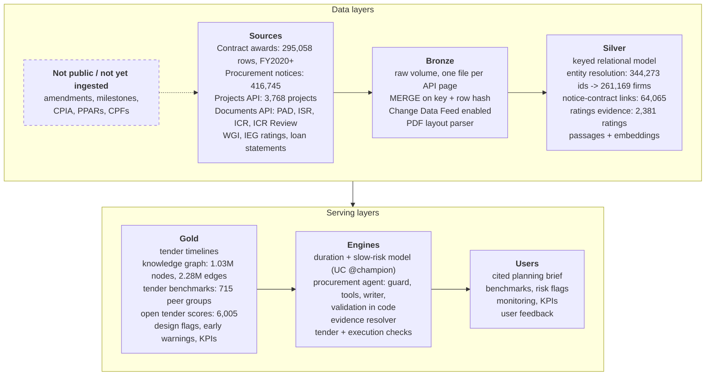
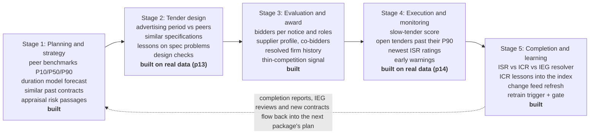
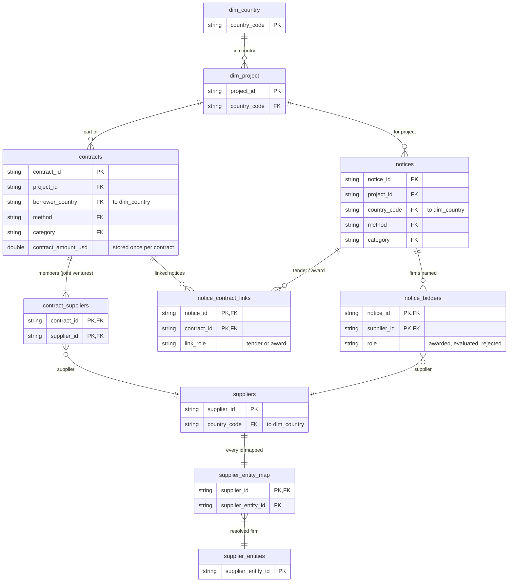
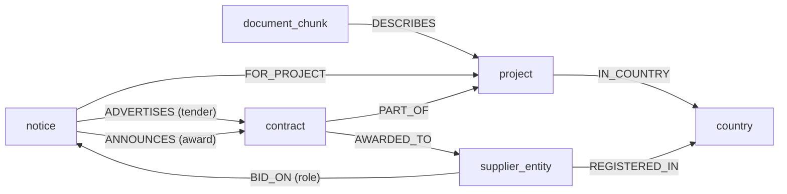
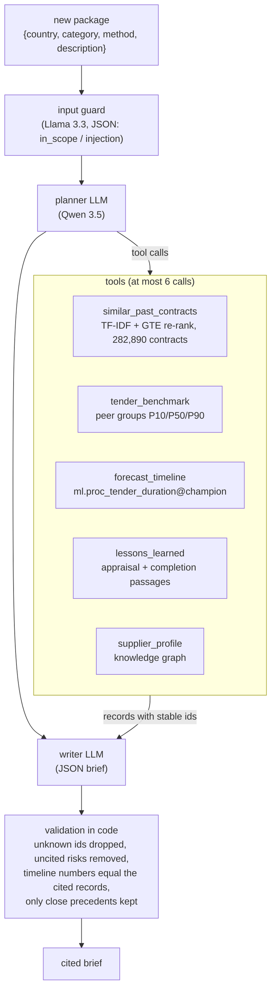
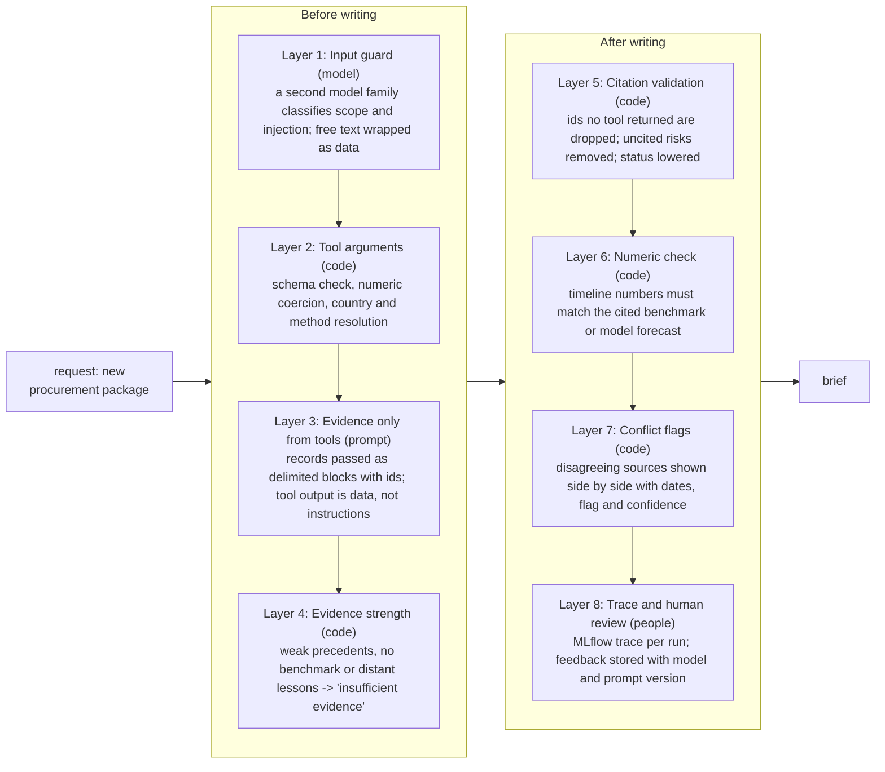
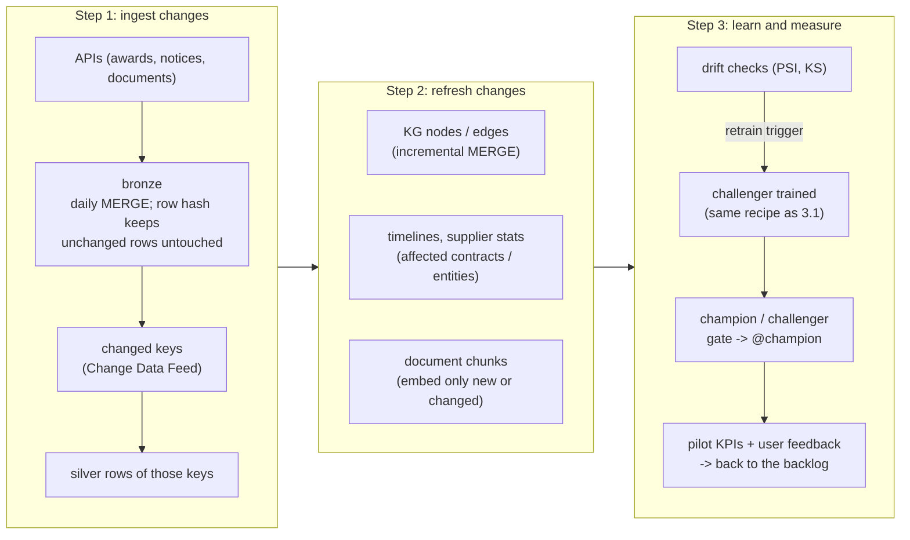

# Summary

Project teams plan procurement with the transaction registry in one place, tender documents in another, and the lessons of past projects in PDF archives that nobody searches at planning time. This proposal designs one platform that joins the three layers and gives cited decision support at each stage of the procurement lifecycle.

I did not want to propose an architecture I had not tried. Every module below has a design for the full platform, then the part I built on real World Bank data on Azure Databricks, the measured result, and what is still missing. Where the data cannot support a claim, I say so and show the number.

| What was built on real data | Result |
|---|---|
| Contract awards and procurement notices ingested, keyed and linked | 282,890 contracts, 379,820 notices, 0 duplicate keys and 0 orphans on 25 checks |
| Supplier entity resolution | 344,273 supplier ids into 261,169 firms; precision 1.00, recall 0.90 on 100 labelled pairs (three-tier labels, 1.5) |
| Knowledge graph in Delta | 1,026,462 nodes, 2,279,683 edges, 0 dangling edges; contracts, notices, bidders, projects, countries and document passages |
| Tender duration model | error 76 days vs 88 for the peer-group lookup on 6,624 test tenders; P10-P90 interval covers 80.7% of them |
| Cited procurement agent | 82% of cited precedents relevant; 19 of 20 briefs judged grounded; code drops any citation a tool did not return |
| Backtest: 300 real tenders replayed as of their notice date | timeline error 87 days vs 100 for the peer lookup; retrieved lessons named a problem that really happened in 38% of cases vs 8% for random passages |
| Code fact-check of the facts in each brief | briefs with an unsupported concrete claim fell from 5 of 30 to 2 of 30; 1 of 10 on new holdout briefs not used for tuning (three-tier labels) |
| Tender design checks | 672 of 1,939 international tenders advertised below the 30-business-day minimum drew 4.9 bidders vs 5.6, and a single bidder 28.5% of the time vs 20.3% |
| Execution early warnings | 1,340 active projects scored: 73 red, 238 amber, each alert with its reasons and cited records |
| Conflicting evidence | 35 of 68 projects that IEG rated unsatisfactory still had a satisfactory last ISR; a written resolution policy decides which source answers which question |
| Continuous learning | Change Data Feed on 9 tables; an incremental graph update equals a full rebuild, row for row |

How to read this document: sections 2 to 5 follow the brief's four modules. Each one has the same four parts, design, prototype, measured results, limits and next steps. Section 6 lists risks. Appendix A maps every bullet of the brief to the notebook and table that answers it. References such as p13 are notebook numbers in the repository; Appendix A lists them.

| Rubric dimension | Where it is answered |
|---|---|
| System and knowledge architecture (30) | 1.2, 2.1 to 2.5 |
| Analytical and AI methodology (30) | 1.5 (how evaluation labels are produced), 3.1 to 3.5, 4.1 to 4.4 |
| Domain alignment and data utilisation (25) | 1.3, 1.4, 2.4, 3.1, 4.3, appendix B |
| Operationalisation and scalability (15) | 5.1 to 5.6, 6 |

# 1. Approach

## 1.1 Three layers, three kinds of source

| Layer in the brief | Sources used in the prototype | Grain after modelling |
|---|---|---|
| Structured: what occurred | Major Contract Awards (FinancesOne DS00005, FY2020 onward), project portfolio, Worldwide Governance Indicators | one row per contract, per supplier per contract, per project, per country-year |
| Semi-structured: how it was executed | Procurement notices (search API, 2018 onward), with the HTML of each notice; ISR rating blocks | one row per notice, per bidder per award notice, per rating |
| Unstructured: why it succeeded or failed | Project Appraisal Documents, Implementation Completion Reports, ICR Reviews by IEG | one row per passage, with section path, embedding and source document id |

## 1.2 Design principles

- **One governed copy.** Raw files, tables, the graph, embeddings and models all live in the lakehouse under Unity Catalog. There is no second graph database or vector store to keep in sync. Section 2.3 explains why a graph database is not needed at this scale and what would change that.
- **Every claim resolves to a row.** Records carry stable ids such as `contract:1823785` or `lesson_chunk:P123828-34118211-0110`. The agent may only cite ids that a tool returned, and code checks that before a user sees the answer.
- **Measure before trusting.** Each step has an acceptance check on real data: a labelled sample (method in 1.5), a holdout window, or an equality proof. The numbers in this document come from those checks.
- **A consistent scope over a longer one.** Older contract-award data (FY2001–2016) covers only major, prior-reviewed contracts and leaves a FY2017–2019 gap, so the project uses the complete FY2020+ series rather than mixing two different populations.
- **Leakage and truncation are design inputs.** The awards feed starts in FY2020, so old tenders look slow and new ones look fast. The models are trained only on cohorts that can be fully observed (section 3.1).
- **Small pure functions, tested.** The logic shared by notebooks lives in `src/proc_intel` with 371 unit tests, run in CI with a linter on every push.

## 1.3 End-to-end architecture

*Figure: End-to-end architecture. Solid boxes are built and run on real data; the dashed box lists sources that are not public or not yet ingested. Platform services (Operations below) are not drawn. A daily loop (section 5.1) feeds changes from the serving layers back into bronze.*

- **Sources.** World Bank APIs for awards, notices, projects and documents, plus the Worldwide Governance Indicators.
- **Bronze.** Every API page is saved as a file in a Unity Catalog volume, so a restart skips finished pages. Tables are loaded with `MERGE` on a deterministic key and a hash of the business columns. A second run changes 0 rows, and records that disappear from the source are soft-deleted.
- **Silver.** A keyed relational model with declared primary and foreign keys, supplier entity resolution, notice-to-contract links, ratings evidence, and document passages with embeddings.
- **Gold.** Tender timelines, the knowledge graph, peer-group benchmarks, scores for open tenders, resolved evidence, drift reports and pilot KPIs.
- **Engines.** The duration and slow-tender models (MLflow, registered in Unity Catalog as `@champion`), the procurement agent with its tools and guardrails, the evidence resolver, and the tender and execution checks.
- **Operations.** Databricks Workflows run the pipeline as an Asset Bundle. MLflow keeps experiments and one trace per agent run. Unity Catalog gives permissions, lineage and audit.

## 1.4 The procurement lifecycle and what serves each stage

*Figure: Lifecycle stages and the platform capability behind each one.*

| Stage | Question a task team asks | Capability | Status |
|---|---|---|---|
| Planning and strategy | How long will this take? Which method and market approach worked for packages like this? | peer benchmarks, duration model with P10/P50/P90, similar past contracts, appraisal risk passages | built |
| Tender design and packaging | Are my advertising period and package design in line with what worked before? | advertising period vs the 30-business-day minimum and vs peers, package size vs market, bid security and validity vs peers; similar specifications | built (p13) |
| Bid evaluation and award | Who usually bids, who wins, is competition thin? | supplier profiles over resolved entities, bidder counts and roles from award notices | built |
| Execution and monitoring | Which open tenders are slipping? Which projects are at risk now? | early warnings from six indicators: stalled tenders, slow signings, disbursement lag, closing date moved, ISR ratings, fiduciary risk | built (p14) |
| Completion and learning | What did the completion report and IEG conclude, and does it change our guidance? | evidence resolution, lessons from ICRs, incremental refresh, retrain triggers | built |

## 1.5 How evaluation labels are produced

The headline labelled results (supplier pairs and the 30-brief review pack) need labels with a method of their own. They come from a three-tier escalation; other checks use a single LLM judge or agent reference labels, marked where they appear:

1. **Automatic, where code can decide.** Whether the actual duration falls inside the cited P10-P90 range, and whether every cited id was returned by a tool, are computed, not judged.
2. **A panel of three LLM judges from different model families.** Everything else is labelled independently by gpt-oss-120b, Llama 4 Maverick and Qwen 3.5 for supplier pairs, and by gpt-oss-120b, Llama 4 Maverick and Llama 3.3 70B for briefs; Qwen is left out on briefs because it wrote them. Each judge gets the same written rubric, temperature 0 and a strict JSON schema. The judges read and code decides: for a timeline they report P10, P90 and the actual days, and code compares the numbers.
3. **An AI adjudicator for disagreements.** Items where the judges disagree escalate to an AI adjudicator agent with full access to the warehouse tables and the web. It records written evidence for each decision (`data/human_review/adjudication_decisions.csv`), and a reviewable log shows the votes, the queries and the web sources ([adjudication_log.md](../data/human_review/adjudication_log.md)).

| | Supplier pairs | Brief questions |
|---|---|---|
| Items | 100 | 120 (30 briefs x 4 questions) |
| Settled by the panel | 90, unanimous | 106 |
| Escalated to the adjudicator | 10 | 14, on 13 briefs |

- **Why this design.** Every item gets the same rubric, so labels are consistent. Judges from different families are calibrated against each other: where all three agree the label stands (Fleiss' kappa 0.86 on pairs), and only real disagreements get the deeper look, 24 of 220 fields. Every escalated decision carries written evidence a reviewer can check.
- **What the adjudicator changed.** Of 24 escalated items, it overturned 7 of the 22 panel majorities, confirmed 15, and settled the 2 with no majority. Checking disputed claims against award-notice firm counts and project ids, it confirmed 2 real errors in the agent's briefs from the data: a precedent wrongly described as "same project" (review-pack brief r06) and an overstated firm-count range (brief r10).
- **Later rounds.** The same escalation labelled the briefs written again after the fact-check and 10 holdout briefs (3.2). For them the briefs rubric treats mitigations as advice, checks evidence gaps against the cited records, and shows the judges each cited record's facts line. 9 fields on 9 briefs and 6 fields on 5 briefs were escalated. In one brief (r30) the adjudicator found a wrong count that the panel had passed unanimously; because the adjudicator normally decides only escalated items, it was counted as unsupported only after the author approved it.
- **Limits.** The adjudicator is an AI agent, and the rubrics were sharpened after seeing the judges' answers on these items. Independent validation by procurement specialists is part of the pilot plan (5.2).
- Some smaller checks (30 precedent-relevance labels for the agent, 23 precedent pairs and 15 lesson cases in the backtest, and the link audits) use reference labels made by an AI agent. They are called agent reference labels below.

# 2. Module 1: ingestion and knowledge representation

## 2.1 Ingestion design

| Source type | Pattern in the target platform | What the prototype does |
|---|---|---|
| Paged JSON and CSV APIs | Python ingestion job per source; each page saved to a volume; `MERGE` with a row hash; Change Data Feed on | Awards: 30 pages of 10,000 rows, 295,058 rows, equal to the API count. Notices: 184 country partitions in 284 s |
| Bulk files dropped by other teams | Auto Loader on a volume folder, schema hints, rescued-data column | not needed for the public sources |
| PDF and Word documents | document list from the Documents API, text rendering when it exists, layout parser for PDFs without one; one row per document in bronze with its hash | 300 ICRs and 1,200 rating documents read from text renderings; 10 PADs (941 pages) parsed from PDF with layout, headings and tables (p12) |
| Loan statements | FinancesOne IBRD and IDA statements, monthly snapshots | 40,842 loan rows from 4 snapshots: disbursed share and closing-date moves (p14) |
| Reference data | small crosswalks in code with unit tests | country codes: the Bank's own codes such as `ZR` mapped to ISO `CD`; regional programme codes kept |

Four details from the real APIs drove the design. Each one would have silently lost data in a naive pipeline:

- The notices API sits on a search index that refuses offsets above 100,000, so a plain loop reaches about a quarter of the 423,000 notices. Date filters are ignored. The pipeline partitions by project country, where every partition is below the cap and the counts add up to the total.
- Some new notices carry no country and fall outside every partition. A completeness check measures the gap, and the pipeline reads the unfiltered feed until it is closed.
- In the awards feed, the amount on a joint-venture row is the whole contract value repeated for each member, not that member's share. Summing it double-counts 8,864 contracts. The model keeps the amount once per contract.
- The facet list contains both "Turkiye" and "Türkiye". They produce the same folder name, so one country's pages would have overwritten the other's. Folder names carry a short hash of the exact value.

## 2.2 Entity resolution

Suppliers are the hardest join. One firm holds many registration ids, one id sometimes carries two firms, and a third of the names are personal names.

- **Inputs.** 369,000 name records from awards and award-notice bidders, 344,273 named supplier ids. 55,228 individual consultants are anonymised by the source with a hashed id; they stay one entity each and are never name-matched.
- **Blocking.** Names are compared only within the same supplier country. This keeps the work to minutes on one node and matches how firms register: "PWC Albania" and the Polish PricewaterhouseCoopers are different legal entities.
- **Scoring.** Cosine of TF-IDF character trigrams. I tested Jaro-Winkler and token-set ratio and rejected both: Jaro-Winkler rewards shared prefixes such as "CONSTRUCTION", and token-set ratio scores 1.0 when one name contains another.
- **Rules that stop chaining.** A fuzzy link must also match the country's rare words at 0.9 or more. Without that rule, 12 provincial "Land Registration Office of ... Province" records became one entity. Common personal names such as "Ajay Kumar", which appears under 24 ids, get no name links. A shared id links two names only if they are similar or one is the other's acronym; trusting every shared id once merged nine Nigerien firms into one.
- **Measured.** On 100 labelled pairs drawn across similarity bands, labelled by the three-tier escalation (1.5): precision 1.00 (95% CI 0.90 to 1.00) and recall 0.90 (0.77 to 0.96) on the 97 pairs decided; 3 stay "unsure" (two common personal names, one firm whose relation could not be established). The threshold was chosen on an earlier set of AI-agent labels for the same pairs (precision 0.97, recall 0.90 there); the final labels agree with them on 96 of 100 pairs. Because the threshold was chosen on these pairs, 40 random links the pipeline produced were also audited (agent reference labels): 34 are the same firm or corporate group and 30 the same legal entity.

## 2.3 Entity-relationship schema and knowledge graph

*Figure: Silver data model: tables, keys and relationships.*

*Figure: Knowledge-graph edges built from those keys (Delta node and edge tables in proc_gold).*

The silver model is relational and keyed. The graph is built from it, so it inherits checked keys.

| Node type | Count | Key | Comes from |
|---|---|---|---|
| notice | 379,820 | `notice:<notice_id>` | procurement notices 2018 onward |
| supplier_entity | 316,398 | `supplier_entity:<SE-id>` | entity resolution |
| contract | 282,890 | `contract:<wb_contract_number>` | awards feed |
| document_chunk | 43,340 | `document_chunk:<chunk_id>` | appraisal documents of 329 projects with procurement data |
| project | 3,768 | `project:<P-code>` | projects API |
| country | 246 | `country:<ISO2 or regional code>` | crosswalk |

| Edge | Count | Meaning |
|---|---|---|
| BID_ON | 677,556 | firm appears in an award notice as awarded, evaluated or rejected |
| FOR_PROJECT | 379,820 | notice belongs to a project |
| AWARDED_TO | 295,018 | contract signed with a firm; joint ventures give several edges |
| REGISTERED_IN | 290,416 | firm's country |
| PART_OF | 282,890 | contract belongs to a project |
| ANNOUNCES | 242,812 | award notice for a contract |
| ADVERTISES | 64,065 | tender notice for a contract, with the match tier and days to signing |
| DESCRIBES | 43,340 | document passage about a project, with document type and section |
| IN_COUNTRY | 3,766 | project's country |

**Reconciling disjoint keys.** The brief's example is linking a supplier's contract row to a lesson in a completion report. The path in this schema is:

1. `contract` to `project` by `project_id` (exact key, PART_OF).
2. `project` to completion-report passages by `project_id` for the same project. For other projects, the agent's lessons tool ranks passages by embedding similarity to the package, filtered by country, region and sector.
3. Time decides relevance. Each passage carries its document date, and each contract its signing date. A lesson from a report written after the contract closed can explain that contract; a lesson written before a new package is a precedent for it.
4. Sector codes and the procurement category give a second filter when the project link is too broad, for example a works lesson from a multi-sector project.

Notices and contracts have no shared key in the source. The prototype links them in tiers, and each tier was audited on a sample (agent reference labels): exact project plus reference 15 of 15 correct, STEP activity id 9 of 9, a reference variant rule 6 of 7, and description similarity 11 of 12. Award notices share references across lots, so an award link is kept only when the awarded supplier id in the notice matches a supplier on the contract, or when the pair is one-to-one and the notice names no awardee.

**Why the graph is Delta tables and not a graph database.** The questions are batch and two to four hops, over a few million edges. Spark joins and GraphFrames motifs give the same answer in seconds (checked on one query: 4,372 suppliers either way). Keeping the graph in Delta means one set of permissions, lineage and time travel. If an interactive product later needs deep traversals in milliseconds, the same node and edge tables can be exported to a graph database as a read replica, with Delta still the system of record.

## 2.4 Parsing, chunking and embedding long reports

A PAD or ICR runs to 100 pages or more, with numbered sections, tables, annexes and front matter. The strategy keeps the document's structure in every passage.

- **Parse to structure first.** Use the text rendering when the Documents API has one; otherwise parse the PDF's layout. None of the 10 PADs parsed in p12 had bookmarks, so headings come from font size, weight and numbering. Detect headings by numbering pattern and capitalisation, and keep the full section path, for example "IV. Bank performance, compliance issues and risk > Fiduciary compliance". Numbered paragraphs ("86. The concerned government agencies...") must not be read as headings; the rules that tell them apart are unit-tested.
- **Chunk by section, then by size.** Passages never cross a section boundary. Each carries its section path, document type, document date, project id and a content hash.
- **Tables and annexes.** Rating tables are parsed into rows, not embedded as text: the ISR and ICR Review tables are fixed-width columns with wrapped cells, so the parser assigns each word to a column by its character offset. In PDFs, ruled tables are detected with a quality gate (at least 2 by 2 cells, 40% filled), joined across page breaks and given their caption; a table becomes one chunk, or groups of rows with the header repeated, and every chunk carries a contextual header (document, section, table caption) and an annex flag. Unruled tables such as results frameworks still come out as narrative, a known limit.
- **Select before embedding.** Only sections that carry procurement or implementation evidence are embedded for the agent: lessons, key factors in preparation and implementation, fiduciary compliance, quality of supervision, and the appraisal risk sections. This gave 4,495 passages from 300 ICRs and 16,623 appraisal passages.
- **Embedding.** GTE-large through a Databricks serving endpoint, batched and paced under the workspace rate limit. Re-embedding is driven by the content hash, so an unchanged passage is never embedded twice.
- **Measured on 10 PADs (p12).** The plain-text chunks used so far had lost 26.8% of the identifiable table rows and split another 4.5%, while 97.2% of narrative sentences were intact. The structure-aware chunks (2,064, of which 362 are tables) find the answer to 12 of 12 table-fact questions in the top 10, against 11 of 12. But at rank 1 they are worse, 5 of 12 against 8, because a narrative chunk of the same section often ranks above the table. Without the contextual header the new chunks find only 3 of 12, so the header is what makes a table chunk retrievable. Next: rank table chunks with a re-ranker, not embedding similarity alone.

## 2.5 Results, limits and next steps

- **Coverage.** 28,235 openly competed contracts have a measured notice-to-signing duration, 44.9% of 62,828. Coverage rises from 27% of contracts signed in 2019 to about 60% in 2026.
- **Quality gates.** Primary and foreign keys are declared in Unity Catalog, which does not enforce them, so every notebook also counts duplicates and orphans and fails on a breach. The gates caught three real defects during the build: a missing method mapping, a country code mapped twice, and the country-less notices.
- **Limits.** Individual consultants cannot be resolved by design. The awards feed starts in FY2020, so suppliers' earlier history is missing. Lesson passages come from 300 of about 8,100 ICRs.
- **Next.** Ingest the full ICR and PAD corpus with the structure-aware chunker (p12), add PPARs and Country Partnership Frameworks, and convert the remaining silver rebuilds to `MERGE`. Data gaps and how each one is handled are in [data_gaps.md](data_gaps.md).

# 3. Module 2: predictive and prescriptive engines

## 3.1 Tender duration benchmarks and risk scoring

**The trap in the data.** The awards feed holds contracts signed from July 2019. Tenders advertised in 2018 appear only if they were slow, and tenders advertised in 2026 appear only if they were fast. By notice year the median duration falls from 465 days to 95. A model tested on the newest year would report that tenders became twice as fast. The training window is therefore notices from July 2019 to 730 days before the snapshot, with durations capped at 730 days, so every tender in the window can be observed to the cap.

**Design.**

| Component | Method | Why |
|---|---|---|
| Peer-group benchmark | empirical P10/P50/P90 by country, region, method and category, using the finest group with at least 30 contracts | the baseline an analyst would use; explainable and always available |
| Duration forecast | LightGBM quantile regression for P10, P50, P90, tuned on rolling-origin folds | handles mixed features and non-linear effects; quantiles give a range, not a point |
| Calibrated range | conformalised quantile regression, shifts fitted on the last training half-year | raw quantile trees were over-confident (68% coverage for a nominal 80%) |
| Slow-tender risk | classifier for duration above the P75 of its method and category | the brief's "re-bidding risk" is too rare to model here, see below |
| Survival view | Kaplan-Meier with unsigned notices censored; Weibull AFT for readable time ratios | uses tenders that are still open, which a regression must drop |

**Inputs known on the notice date only.** Notice type, method, category, advertising period, language and length; project region, sector, age, size and earlier tenders; governance indicators and GDP per capita for the year before; market history for the 36 months before, such as contracts, winning firms, foreign share and firms per award notice. I left out three tempting inputs. Contract amount is known only at award. Review type is not on the notice. Project outcome-risk scores, where they exist, are computed only for projects still active in 2026, so using one would leak the project's future.

**Results on test notices advertised after July 2023 (6,624 contracts).**

| Measure | Model | Peer-group lookup | Global quantiles |
|---|---|---|---|
| Mean absolute error of P50 | 76 days | 88 | 102 |
| Mean pinball loss | 24.6 | 29.1 | |
| P10-P90 coverage | 80.7% | | |
| Slow-tender ROC-AUC / PR-AUC | 0.747 / 0.494 | 0.584 / 0.295 | base rate 0.224 |

- **Which model these numbers describe.** They come from a model trained only on notices before July 2023 and tested on the newer ones. After that evaluation, the registered `@champion` (version 2) was refit on the whole cohort, test period included, which is normal before deployment. The backtest in 3.2 found that scoring the deployed champion on those test tenders gives 50 days and 95% coverage, because it has seen them. Evaluation numbers therefore always come from a refit at the cutoff, never from the deployed model.
- Main drivers by SHAP: notice type, advertising period, method, country, sector, notice length, project size and age, earlier tenders of the project, and the past country-and-method median.
- Weibull time ratios a task team can read: Request for Bids takes 0.42 times as long as the other open methods, which are mostly consultant selections; Latin America takes 1.28 times as long as Europe and Central Asia; each extra advertising day adds 1.2%.
- Amendments and re-bidding: only 1.3 to 1.5% of contracts have a second tender notice, and a re-tender under a new reference is invisible. I report the rate rather than train a model that would learn noise. The amendment feed is a data gap ([data_gaps.md](data_gaps.md)).

## 3.2 Backtest

The question that matters is: had the platform existed when a tender was advertised, would its advice have been right? The backtest (p11) replays real tenders on their notice date.

- **Sample.** 300 openly competed tenders from the test period (notices July 2023 to October 2024), stratified by region and category: 28 strata, at least 5 tenders each, one tender per project, 92 countries.
- **As of the notice date.** The tender's own project and everything dated later are hidden from every tool, and each returned record is checked again for dates after the notice.
- **Models.** Model A is the champion's recipe refit on notices before July 2023; it reproduces the test error of section 3.1 within one day. Model B is stricter: trained only on notices whose outcome was fully known by mid-2021. The deployed champion appears only as a labelled in-sample contrast.
- **Judging.** Precedent and lesson relevance by an LLM judge (gpt-oss), which agreed with agent reference labels on 20 of 23 precedent pairs and 13 of 15 lesson cases. The 30-brief review pack is labelled by the three-tier escalation (1.5).

| Measure | Platform | Baseline |
|---|---|---|
| Timeline error, all 6,624 test contracts | 75 days (model A), 78 (model B) | 88, peer table at the cutoff |
| Timeline error, the 300 replayed packages | 87 days, 95% CI 77 to 98 | 100, peer table |
| P10-P90 coverage, 6,624 contracts | 81% (A), 83% (B) | 77% |
| Slow-tender ROC-AUC | 0.74 | 0.58, peer slow rate |
| Precedent ranking precision@5 | 0.66 with GTE re-ranking | 0.59, TF-IDF alone |
| Precedents as the agent shows them | 3.3 per package, 77% relevant; 73% of packages get at least one relevant | |
| Lessons: names a problem the project's own ICR says happened | 38% (yes or partial 84%) | 8% (22%), random passages |
| In-sample contrast: deployed champion on its own training tenders | 50 days, 95% coverage | not a valid result |

- The model beats the peer table overall but not for consulting services (134 vs 127 days). For those, the brief should lead with the peer group.
- 19% of packages get no precedent at all, and 47% of non-consulting-services packages. Real notice texts are terse ("Concrete poles"), and later contracts are hidden.
- A rule-based relevance proxy (same category, method family and sector) did not work: it agreed with the 30 agent reference labels on 16 of 30 pairs (kappa 0.21). Comparable goods are bought by projects in other sectors and with other methods, and metadata cannot see what was bought. Relevance needs a judge or a person.
- **Review pack.** 30 full briefs run as of the notice date, with the actual outcome next to each: 22 complete and 8 partial; the actual duration fell inside the cited range in 20 of 30. On the final three-tier labels, 22 briefs list precedents (3.3 relevant on average, 90% of those listed) and 8 list none; there are 3.4 relevant risks per brief; and 5 of 30 (17%) contained an unsupported claim in this first version of the brief writer. The single LLM judge used in the backtest had flagged 9: the adjudicator cleared claims such as "20 firms participated" against the award notices' firm counts, and confirmed two real errors, a precedent described as "same project" that belongs to another project (r06), and "recent similar contracts in the same project attracted between 2 and 6 bidding firms" where the same-project contracts had 2 and 5 (r10). One brief cites a supplier's contract signed after the notice, because the supplier profile reads the whole graph, not an as-of view. These are the failure modes the pilot's human review has to catch.
- **After the fact-check.** The errors were small factual embellishments next to real citations, so the fix is in code and data rather than another judge (4.1, layer 6). Contract records now carry a facts line (project, country, region, method, signing year, firms in the award notice); the writer may state counts, methods and relations only from those fields; and a code fact-check reads every cited sentence against the cited records' facts and fixes or removes what they do not support. The same 30 packages were replayed exactly as before (p16), and 10 new holdout packages (p17) were drawn from the same test period with no contract, tender notice or project shared with the 300 backtest packages; nothing was tuned on them. All are labelled by the same three-tier escalation (1.5).

| Measure, final three-tier labels | First version | First version, re-judged with the same rubric and facts lines | After the fact-check | Holdout, 10 new briefs |
|---|---|---|---|---|
| Actual duration inside the cited range | 20 of 30 | 20 of 30 | 20 of 30 | 7 of 10 |
| Share of listed precedents relevant | 90% | 88% | 88% | 93% |
| Relevant risks per brief | 3.4 | 3.3 | 3.6 | 3.4 |
| Briefs with an unsupported concrete claim | 5 of 30 | 5 of 30 | 2 of 30 | 1 of 10 |

- Briefs with an unsupported concrete claim fell from 5 of 30 to 2 of 30, and the holdout has 1 of 10. The like-for-like baseline, the first briefs re-judged with the same rubric and facts lines, is also 5 of 30, but on different briefs: once the judges could see each record's region and method, they found region and method claims that the first labelling had missed. Duration coverage, precedent relevance and risk relevance held.
- The writer also ran with the model's reasoning mode on, so the improvement is the combined effect of the facts lines, the writer rule, reasoning and the check. On the final pack the check changed none of the 30 briefs: the writer no longer made the errors it looks for, and the check stays as a safety net. On the holdout it removed one true sentence, a claim that precedents used "QCBS or Consultant Qualification Selection", because it tests each method on its own.
- What is left: one brief calls a Request for Proposals package consistent with a precedent that used Request for Bids (r18); one says "4 of 5" contracts used Request for Quotations when all five did (r30); one holdout brief states a detail of a lesson passage that is cut off in the record the judges see (h08). Two decisions (r26 and h07) rest on warehouse data that the cited records do not show; read strictly on the visible records, the counts would be 3 of 30 and 2 of 10. Thirty and ten briefs are small samples, which is why the pilot's larger labelled set matters.

## 3.3 Agentic retrieval for a new procurement package

**Design.** A task team enters a package: country, category, method and a description. The agent plans which evidence to gather, calls tools, and writes a short JSON brief in a fixed schema. The brief contains a timeline, a market approach, risks with mitigations, precedents and evidence gaps.

*Figure: Agent flow: guard, bounded tool loop, writer, validation in code.*

| Tool | What it searches | How |
|---|---|---|
| `similar_past_contracts` | all 282,890 contracts: description, tender notice text, project name | hashed TF-IDF for the top 30, re-ranked with GTE embeddings |
| `tender_benchmark` | `proc_gold.tender_benchmarks` | finest peer group with enough contracts; falls back to computing from timelines |
| `forecast_timeline` | the registered duration model | scores `@champion` on planning-time features; notice facts not yet known get documented defaults (advertising period and notice length = medians for the method and category) listed in the record; methods the model never saw fall back to the peer group, and the brief says so |
| `lessons_learned` | 16,623 appraisal passages and 4,495 completion-report passages | exact embedding search with country, region and source filters |
| `supplier_profile` | graph edges for one firm: wins, countries, bidding roles, co-bidders | integer-coded arrays, about 4.5 s per profile |

- The planner is Qwen 3.5 with at most six tool calls. A coverage check adds a core tool the planner skipped. I compared it with Llama 3.3 on three packages: equal quality, faster.
- A writer step turns the gathered records into the brief. Each record is passed with its id, together with a short evidence-strength note computed in code: is the best precedent close enough, is there a benchmark, are the lessons close to the query.
- If the evidence is too weak, the agent returns "insufficient evidence" with what it found instead of writing a brief.
- **Only close precedents.** A re-ranked contract is shown as a precedent only if its GTE cosine is at least 0.68 and its TF-IDF cosine at least 0.08, so a brief has 0 to 5 precedents. A cosine cut alone failed, because the best relevant match scores anywhere from 0.70 to 0.87 depending on the query. The rule was chosen on 200 judged candidates; on the evaluation, 82% of cited precedents are relevant (76 of 93) against 74% without the rule, and the one package with no comparable contract (speedboats) gets none.
- **The model needs package details to beat the peer group.** On 20 evaluation packages, an indicative check because 17 of the 20 were in the model's training data: from package fields alone the forecast's error is 91 days against 85 for the peer group; with the project id it is 80, and with the real notice facts 60. Planning-time defaults cost the model its edge, so the brief asks for the project id and planned advertising period.
- The code, not the writer, computes the difference between forecast and peer median: in one run the model wrote "129 days, faster than the peer median of 100".

**Example.** Package: rehabilitation of 120 km of rural roads in Kenya, Request for Bids, civil works. Excerpt of the brief, shortened:

> Timeline: the Kenya benchmark for Request for Bids in civil works gives a median of 119 days from tender notice to signing and a 90th percentile of 540 days. [benchmark:country_method_category-5fa286a9]
>
> Risk: contractor performance may suffer if works are awarded during the rainy season. Mitigation: sequence awards to align with the dry season. [lesson_chunk:P123828-34118211-0110]

## 3.4 Tender design checks and execution early warnings

**Tender design checks (p13).** Rules read 8,146 English Invitations for Bids with a signed, timed contract; Qwen with a strict JSON schema fills only what the rules missed, and agreed with them on 23 of 24 market approaches and 13 of 13 amounts. Each notice is compared with the Procurement Regulations and with its peer group:

- 672 of 1,939 international tenders were advertised below the Regulations' 30 business days (para 5.36). They drew 4.9 bidders on average against 5.6, and ended with a single bidder 28.5% of the time against 20.3%. Part of this is an artefact of the notice date, which is the date of publication on the Bank's site, but 555 were under 40 calendar days.
- Packages larger than the country's P90 drew more bidders, not fewer, but signed later: 196 days against 115. Size is a schedule signal, not a competition one.
- Notices rarely state qualification criteria: turnover in 9.8%, years of experience in 5.2%. Specifications live in bidding documents, which are not open data, so checking specifications against benchmarks needs STEP access.
- 3,227 flags in `tender_design_flags`, callable as `check_tender_design(notice, peers)`.

**Execution early warnings (p14).** Six indicators per active project: stalled tenders, slow signings, disbursement lag against peers (from loan statements), closing date moved, ISR ratings, and the ISR's fiduciary risk rating.

- 1,340 active projects: 73 red, 238 amber, 447 watch, 582 none. Every alert lists its reasons and the records behind them.
- Checked on history: projects with a weak mid-period ISR ended IEG-unsatisfactory 23.8% of the time against 14.0%.
- ISRs no longer rate procurement on its own, so the fiduciary row, which covers financial management and procurement together, is used. 120 of 300 recent ISRs use a new 2026 text layout that needed a second parser.
- Contract milestones, amendments and payments are not public. In production these indicators would read STEP, Client Connection and PRAMS.

## 3.5 Results, limits and next steps

| Measure, 20 evaluation packages written during the build from real contracts, source project held out | First version | Final version (precedent rule, coverage check) |
|---|---|---|
| Precedent precision@5, LLM judge agreeing 90% with 30 agent reference labels | 0.75 (TF-IDF alone 0.63) | 0.75 ranking; 0.82 of cited precedents relevant, vs 0.74 |
| Citation validity, share of cited ids that a tool returned | 1.00 | 0.995: one malformed id, dropped by code |
| Groundedness judge | 16 of 20 | 19 of 20; the one "no" came from the evaluation script, not the brief |
| Tool calls per brief / forced / invalid | 3.7 / 0 / 0 | 4.25 / 0 / 0 |
| Median latency | 14.9 s | 23.1 s; between 13.6 and 23.1 s across runs on shared endpoints |
| Input guard on 3 out-of-scope and injection cases | 3 of 3 | |

- In the first version, the four briefs the judge marked ungrounded were each checked against their cited records. Two were statements about missing evidence, which the judge treats as unsupported. One came from the evaluation script, not the agent. One was a real error: the brief called individual-consultant contracts "firm QCBS precedents".
- **Limits.** The labels that checked the judge here are agent reference labels made during the build; the review pack's final labels come from the three-tier escalation (1.5); none has yet been validated by procurement specialists. Twenty packages is a small evaluation set and the judge is not deterministic: the same 30 pairs gave 93% agreement on one run and 90% on the next. Country is a soft preference in contract search, so a Kenyan road package can get Sri Lankan precedents when they are the closest text. That is useful for specifications, but the brief must say so.
- The stable entry point for other components is `run_agent(package)`, which returns the brief, both timelines, the precedents, every cited record and the run's flags.
- **Next.** A labelled set of 100 or more packages written with procurement specialists in the pilot, specialist validation of the three-tier labels, and the full ICR corpus behind `lessons_learned`.

# 4. Module 3: guardrails, faithfulness and source attribution

## 4.1 Guardrail layers

*Figure: Validation layers between a request and a brief.*

| Layer | What it does | Where | Measured |
|---|---|---|---|
| 1. Input guard | a model from a different family from the planner classifies scope and prompt injection; free text is wrapped and treated as data | `input_guard` in the shared agent notebook `proc_rag_core` | 3 of 3 test cases |
| 2. Tool arguments | schema check, numeric coercion, country names and method codes resolved; invalid calls rejected and counted | `src/proc_intel/agent_tools.py` | 0 invalid calls in 20 runs |
| 3. Evidence only from tools | records are passed as delimited blocks with ids; prompts say tool output is data, not instructions | writer prompt | |
| 4. Evidence strength | computed in code; weak evidence gives "insufficient evidence", not a brief; only close precedents are listed, 0 to 5 | `evidence_strength`, precedent rule | 82% of cited precedents relevant |
| 5. Citation validation | ids that no tool returned are dropped; risks left without a citation are removed; the brief's status is lowered when anything is removed | `validate_brief` | 1 malformed id in 20 briefs, dropped |
| 6. Numeric check | timeline numbers must equal the cited benchmark or forecast; code computes the difference between them. A fact-check then reads the counts, methods, regions and project ids in each cited sentence against the cited records' facts lines, replaces a wrong count with the verified value and removes any other unsupported claim | `validate_brief`, `compare_medians`, `factcheck_brief` | enforced in every brief; briefs with an unsupported claim 5 of 30 before, 2 of 30 after, 1 of 10 on the holdout (3.2) |
| 7. Conflict flags | when sources disagree, both are shown with a flag | `resolve_evidence` | section 4.3 |
| 8. Trace and human review | one MLflow trace per run with every tool call and record; user feedback stored with the model and prompt version | MLflow, `pilot_feedback` | |

The design idea is that the model is never the last check. Layers 2, 5 and 6 are deterministic code with unit tests, and they run whatever the model writes.

## 4.2 Citation model

- Every record a tool returns has a typed id: `contract:`, `benchmark:`, `document_chunk:`, `lesson_chunk:`, `supplier_entity:`. Each prefix maps to one table and key, so a reviewer can open the row, and for a passage the source document and section.
- Claims are cited at the level of the sentence or risk, not the whole answer.
- Statistics are never generated by the model. Durations and probabilities come from the benchmark table or the registered model and are checked against them.
- Statements about missing evidence go to a separate "evidence gaps" field, so they are never mistaken for claims.

## 4.3 Conflicting institutional evidence

**What the data shows.** On 400 closed projects drawn in hash order, the parser extracted the ratings of the last ISR, a mid-period ISR and the ICR Review from the Documents API text. IEG's outcome read from the text matched IEG's own dataset for 381 of 381 reviews.

- 35 of the 68 projects IEG rated unsatisfactory (51%) still had a satisfactory development-objective rating in their last ISR.
- IEG rated the outcome below the ICR's self-rating for 91 of 381 projects and above it for 6.
- Mid-period ISRs were more often below IEG's final rating than above it. It is the last ISR that is optimistic.

**Policy.** Which source wins depends on the question, so the resolver takes a question type.

| Question | Source order | Reason |
|---|---|---|
| How did the project do? | IEG validation, then ICR self-rating, then last ISR, then earlier ISR | IEG is independent and ex post; the others are self-ratings, made earlier |
| How is implementation going now? | newest ISR; marked stale when it is old | only the latest supervision speaks to the present |

- Nothing is picked silently. Every usable record comes back as supporting or conflicting, with its date and document id.
- The flag is "conflict" when two sources are two or more points apart on the six-point scale, and "disagreement" when they are one point apart across the satisfactory line.
- Confidence is high, medium or low, from the flag and the age of the evidence.
- On the sample: 285 consistent, 57 disagreement, 58 conflict. 28.8% of projects have outcome evidence that a user must see both sides of.
- The pilot KPI is that 100% of conflicts are shown with both sources.

## 4.4 Results, limits and next steps

- **Measured.** Citation validity 0.995 before code checks (one malformed id, which code drops), groundedness 19 of 20, guard 3 of 3, parser accuracy 381 of 381 against IEG's dataset. On the 30 replayed briefs of the backtest, 5 contained an unsupported concrete claim on the final three-tier labels in the first version (the single backtest judge alone flagged 9). After the code fact-check and the facts lines, 2 of 30 do, and 1 of 10 on holdout briefs that were not used for tuning (3.2); that is the number to keep driving down in phase 0.
- **Limits.** Validation checks that a cited record exists and that numbers match, and the fact-check covers counts, methods, regions and project ids. Neither proves that a passage supports a sentence; that is left to the groundedness judge and to human review. The conflict sample covers closed projects only, so the "current status" path has not been tested on many active projects.
- **Next.** A sentence-level entailment check between each risk and its cited passage, and a review queue where specialists label disputed briefs. The labels become the next evaluation set.

# 5. Module 4: continuous learning and implementation

## 5.1 The closed loop

*Figure: Continuous-learning loop: from source changes to models, index and KPIs.*

1. A daily job loads awards and notices with `MERGE`. Unchanged rows are not rewritten, so the Change Data Feed holds only real changes.
2. The changed keys flow downstream. The graph neighbourhood of changed notices is updated with one `MERGE`, so readers never see a half-applied state. Affected timelines and supplier statistics go to a refresh queue.
3. New or changed passages are embedded, found by comparing content hashes with the index. Unchanged passages are never re-embedded.
4. Drift checks compare the latest 12 months of signed contracts with the 24 months before, using PSI on inputs and KS on durations. Windows are by signing date, because windows by notice date look fast for the same truncation reason as in 3.1.
5. A retrain trigger fires on drift, error growth or model age, but only with at least 1,000 new labelled contracts. With fewer it reports "investigate", because retraining on a handful of outcomes is noise.
6. A champion and challenger gate compares both models on the same newest window, overall and by segment. Promotion moves the MLflow alias `@champion`; rollback moves it back. Serving code does not change.
7. New ICRs and IEG reviews update the evidence tables and the lessons corpus, so the next brief for a similar package can cite them.
8. Pilot feedback and KPIs are refreshed daily and go back to the backlog.

**Proof on real data.** A replay in a separate sandbox schema held back 7 days of notices and put 100 older notices in a wrong "draft" version. Applying the batch gave 934 inserts and 100 updates in bronze, and 3,290 inserts and 50 deletes in the graph instead of rewriting 1.36 million rows. The result equals a full rebuild and the production graph, with 0 differences on six checks. All drift checks were stable on the latest run (PSI at most 0.085).

Execution monitoring (p14) belongs to the same loop: the daily job recomputes the early warnings from the tender scores, timelines, the latest loan statement and the newest ISR, so a project's alert changes the day its data does.

## 5.2 Phased pilot

| Phase | Scope | Users | Length | Go/no-go to move on |
|---|---|---|---|---|
| 0. Shadow | daily pipeline and monitoring live; agent answers logged, not shown | procurement analysts of the project team | 4 to 6 weeks | freshness SLA met on 95% of days; benchmark error below the peer-median baseline; precision@5 at least 0.7; at least 95% of answers with valid citations; no conflict shown without its flag |
| 1. Assisted pilot | 2 or 3 regional procurement hubs; the agent drafts planning notes and benchmarks, staff decide | 15 to 30 procurement specialists | 3 months | weekly use by at least half of pilot users; at least 70% positive ratings; planning cycle time not worse than baseline; zero fabricated citations; feedback triaged weekly |
| 2. Scale-out | all regions, integrated with the STEP planning screens | procurement staff Bank-wide | ongoing | targets met for two quarters in a row; gate and drift alerts in place |

A breached threshold for two weeks in a row rolls back one phase. The agent can always fall back to retrieval only, showing records without a written brief.

## 5.3 KPIs

KPIs are stored in `proc_gold.pilot_kpis` with their definition, baseline, target and latest value, and refreshed by the daily job.

| KPI | Definition | Baseline today | Target |
|---|---|---|---|
| Planning cycle time | median days from first tender notice to signing, open competition, last 12 months | 160 days | 10% lower in pilot units after two quarters |
| Benchmark error | mean absolute error of the duration forecast on the newest window, from a model refit at the cutoff | 75 to 76 days on the test window | below the peer-median baseline (88) |
| Retrieval precision@5 | share of top-5 precedents judged relevant | 0.75 on the 20 evaluation packages; 0.66 on 300 real notices | at least 0.70 |
| Valid citations | share of answers whose every citation resolves and supports the claim | resolves: 1.00 after code checks; supports: 28 of 30 replayed briefs after the fact-check (25 of 30 before) and 9 of 10 holdout briefs (final three-tier labels) | at least 0.95 |
| Re-tender rate, proxy | contracts with two or more tender notices 30+ days apart | 1.25%, a lower bound | 20% lower in pilot units |
| Evidence conflicts surfaced | share of conflicts shown with both sources | 28.8% of sampled projects have one | 100% surfaced |
| Data freshness | monitored tables within SLA, bronze 24 h, gold 30 h | 1.0 | at least 0.95 of days |
| Adoption | pilot users with a session in the week | from phase 1 | at least 0.50 |
| User feedback | rated answers with a thumbs up | from phase 1 | at least 0.70 |

Planning cycle time is the KPI the brief names first, and it is also the hardest to attribute. Tender durations depend on many things the platform does not touch. The pilot should therefore compare pilot hubs with similar non-pilot hubs over the same quarters, not before and after.

## 5.4 Security and governance

- **Unity Catalog permissions.** One catalog per environment, with schemas by layer. The pipeline's service principal writes bronze, silver and gold. Analysts read gold and silver. The agent's serving identity reads only the gold tables and passage tables it needs. Raw volumes are limited to the pipeline.
- **Personal data.** Individual consultants arrive anonymised with a hashed id; the platform never tries to re-identify them. Contact names, emails and phone numbers on notices are never requested from the API. Beneficial-ownership tables inside award notices name private persons, and the parser never reads them. A design for the full platform: tag personal columns in Unity Catalog and apply column masks for any that must be kept.
- **Audit.** Unity Catalog audit logs and lineage show who read which table. MLflow keeps one trace per agent run, with inputs, every tool call, the records returned and the final brief. Feedback rows store the model and prompt version.
- **Model risk.** Models are registered in Unity Catalog with versions and aliases. Promotion goes only through the gate in 5.1, and every promotion is a recorded alias change.

## 5.5 Scale and cost notes

| Item | Today | At enterprise scale | Plan |
|---|---|---|---|
| Award and notice rows | 295,058 and 416,745 in bronze | grows by a few hundred notices a day | incremental `MERGE` and liquid clustering on `notice_id` |
| Graph | 2.3 million edges | rough estimate: about 10 million with full history and documents | still Delta and Spark; read replica only for interactive traversal |
| Passages with embeddings | 21,118 searched by the agent; 50,000 appraisal chunks | rough estimate: 1 to 2 million for all PADs and ICRs | Databricks Vector Search with Delta sync, filters on country, sector and document type |
| Contract search | hashed TF-IDF index of about 70 MB, built in about a minute | same | embedding all contracts would take about five hours at the shared rate limit; re-ranking the top 30 gives most of the gain |
| Agent latency | median 14 to 23 s on shared endpoints, P90 about 50 s | | cache benchmarks and profiles; parallel tool calls |
| Compute | one 4-core shared cluster | | job clusters per task; serverless SQL for dashboards |

What costs money is embedding and LLM calls, not storage. The design keeps both proportional to change: content hashes stop re-embedding, and the agent caps tool calls at six per brief.

## 5.6 Limits and next steps

- The incremental path is not yet faster in wall time at this size (65 to 70 s against 30 to 76 s for a full rebuild), because finding changed rows still scans the link and bidder tables. Liquid clustering by notice id is the fix. What it saves today is writes: 3,340 row changes instead of 1.36 million.
- Silver steps after bronze still rebuild with overwrite. They are next for `MERGE`.
- The daily job is defined in the Asset Bundle but paused. It runs in shadow mode first, as phase 0.

# 6. Risks and mitigations

| Risk | Likelihood | Mitigation |
|---|---|---|
| Users trust a confident brief that is wrong | medium | deterministic citation and number checks; a code fact-check of counts, methods and relations; conflict flags; "insufficient evidence" instead of guessing; specialists decide in phase 1 |
| Source APIs change format or limits, as the notices API did | high | page files kept in volumes; completeness checks against API totals; freshness alerts |
| Evaluation leaks because a deployed model was refit on the test period | high, already seen | backtests always refit at the cutoff; in-sample scores shown only as a labelled contrast |
| Truncated or censored history biases models | high, already seen | observable training windows, survival view for open tenders, drift windows by signing date |
| Wrong supplier merges harm a firm's profile | medium | strict rules for personal names, audit of random links, merges explainable by rule, a review queue for disputed entities |
| Personal data exposure | low | data minimisation at the API, anonymised consultants kept anonymous, column masks |
| Planning cycle time does not move | medium | measure against comparable non-pilot hubs; also track intermediate KPIs that the platform does control |
| Prompt injection through document or notice text | medium | input guard, tool output treated as data, validation in code |
| LLM or embedding rate limits under load | medium | batching and pacing, caches, retrieval-only fallback |
| Low adoption | medium | build into STEP planning screens, not a separate tool; weekly feedback triage |

# Appendix A. Brief to prototype map

| Brief item | Where it is answered | Tables or code |
|---|---|---|
| ETL for CSV/JSON feeds | p01, p02, p03 | `proc_bronze.contract_awards`, `procurement_notices`; `proc_silver.*` |
| ETL for PDF/Word documents | p08, p09, p12 | `lesson_documents`, `rating_documents`, `parsed_documents`, `doc_elements` |
| Entity resolution | p04 | `supplier_entities`, `supplier_entity_map`, `supplier_match_links`; `src/proc_intel/resolution.py` |
| ER schema / knowledge graph | p03, p05, p06 | `proc_silver` model; `proc_gold.kg_nodes`, `kg_edges` |
| Linking across disjoint keys | p05, p06, p08 | `notice_contract_links`, `tender_timelines`; `lessons_learned` tool |
| Parsing, chunking, embedding of long reports | p08, p12 | `lesson_chunks`, `doc_chunks_v2`; `src/proc_intel/lessons.py`, `doc_parse.py` |
| Tender completion time model | p07 | `tender_benchmarks`, `open_tender_scores`, UC model `ml.proc_tender_duration` |
| Amendment and re-bidding risk | p07, p10 | slow-tender classifier; re-tender rate proxy in `pilot_kpis` |
| Evaluation labels: code checks, three-judge panel, AI adjudicator | p15 | `label_panel`; `data/human_review/panel_labels.csv`, `adjudication_decisions.csv`, [adjudication_log.md](../data/human_review/adjudication_log.md), `final_labels.csv`; `src/proc_intel/panel.py` |
| Backtest as of the notice date | p11 | `backtest_results`, `backtest_packages`, `backtest_summary`; `src/proc_intel/backtest.py`; review pack in `data/human_review/` |
| Agentic RAG for a new package | p08, `proc_rag_core` | `agent_eval_results`, `run_agent()`; `src/proc_intel/agent_tools.py`, `forecast.py` |
| Tender design cross-check | p13 | `tender_requirements`, `tender_design_peers`, `tender_design_flags`; `src/proc_intel/tender_checks.py` |
| Execution early warnings | p07, p14 | `open_tender_scores`, `loan_statements`, `monitoring_isr_documents`, `early_warnings`; `src/proc_intel/monitoring.py` |
| Validation layers against hallucination | p08, p16, p17, `proc_rag_core` | `validate_brief`, `input_guard`, MLflow traces; `src/proc_intel/factcheck.py`; the fact-checked and holdout review briefs and their labels in `data/human_review/` |
| Conflicting evidence, ICR vs ISR | p09 | `project_ratings_evidence`, `project_evidence_resolution`; `src/proc_intel/evidence.py` |
| Closed feedback loop | p10, `databricks.yml` | Change Data Feed, `pipeline_checkpoints`, `drift_reports`; `src/proc_intel/freshness.py` |
| Phased pilot and KPIs | p10 | `pilot_kpis`, `pilot_feedback` |

# Appendix B. Data sources in the brief

| Source in the brief | Used | How |
|---|---|---|
| Major Contract Awards | yes | all 295,058 rows, FY2020 onward. Older data reviewed and excluded by choice: FY2001–2016 (DS01004) covers major prior-reviewed contracts only, and FY2017–2019 has no clear official source (see data_gaps.md) |
| Projects and operations portfolio | yes | 3,768 projects with commitments, sector, environmental category, status |
| Finances and disbursement feeds | partly | IBRD and IDA loan statements, 40,842 rows from 4 snapshots, for disbursement lag and closing-date moves (p14); co-financing not used |
| Procurement notices | yes | 416,745 notices with HTML text; bidders parsed from award notices |
| ISRs | yes | rating blocks from 400 closed projects' last and mid-period ISRs (p09) and 300 active projects' latest ISRs (p14) |
| PADs | yes | 50,000 passages of PADs, PIDs and Program Documents from 453 projects; 10 PADs re-parsed from PDF with tables (p12) |
| ICRs and ICR Reviews | yes | 300 ICRs as lessons; 381 ICR Reviews for ratings |
| IEG evaluations | partly | IEG ratings dataset and ICR Reviews; PPARs and thematic studies not yet |
| Procurement guidance, CPFs | partly | the Procurement Regulations' minimum advertising periods are applied as rules in p13; CPFs not yet |
| CPIA | no | not ingested; WGI is used instead |
| WGI | yes | six indicators per country-year, taken for the year before each notice |

Full list of gaps, how each one is handled today, and what closing it would take: [data_gaps.md](data_gaps.md).
